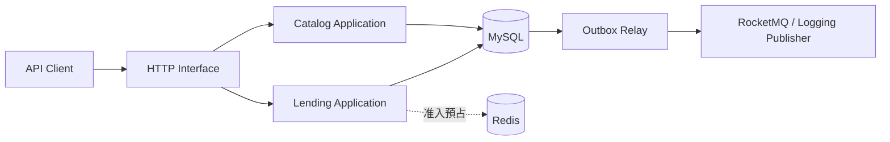

# E-Library 電子圖書館服務

[](https://github.com/ChovyCao2025/e-library-service/actions/workflows/ci.yml)


E-Library 是一個以 Java 21 與 Spring Boot 4 建立的電子圖書館後端範例。專案採用模組化單體與分層架構，實作書目瀏覽、借閱、歸還、持久化冪等、庫存與使用者配額控制，以及交易式 Outbox。

MySQL 保存權威業務狀態；Redis 只負責可重建的准入預占與投影加速，無法單獨建立成功借閱。

> **範圍假設**
>
> 本專案將「瀏覽書籍」定義為瀏覽書目與中繼資料。題目將「瀏覽、借閱、閱讀」列為不同能力，而明確功能清單未要求正文交付，因此 PDF/EPUB 儲存、串流閱讀、下載與 DRM 不包含在本次實作範圍。

## 功能範圍

| 功能 | 狀態 | 說明 |
| --- | --- | --- |
| 瀏覽書籍 | 已完成 | 書名開頭查詢、分類、語言、格式篩選及簽章游標分頁 |
| 查詢書籍詳細資料 | 已完成 | 書目資料、出版資訊與目前可借數量 |
| 借閱書籍 | 已完成 | 配額與庫存終裁、持久化冪等、同書重複借閱保護 |
| 歸還書籍 | 已完成 | 手動與到期歸還，共用冪等交易流程 |
| 查看目前借閱 | 已完成 | 依狀態查詢使用者借閱，支援游標分頁 |
| 管理書目與庫存 | 已完成 | 新增、樂觀鎖更新、上架、下架與調整借閱席位 |
| 數位內容閱讀 | 範圍外 | 後續可加入短效內容授權 URL 與獨立內容服務 |

## 架構概覽



- `catalog`：書目、中繼資料、上架狀態與管理操作。
- `lending`：借閱請求、庫存、使用者配額、Loan 與 Redis 投影。
- `shared`：錯誤模型、身分上下文、游標、ID、設定與 Outbox。
- `application` 編排用例與交易，`domain` 保存領域型別，`infrastructure` 實作資料庫及外部系統，`interfaces` 提供 HTTP API。

完整說明請參閱 [架構文件](docs/architecture.md) 與 [API 文件](docs/api.md)。

## 快速開始

### 環境需求

- JDK 21
- Docker 與 Docker Compose

### 啟動依賴

```bash
docker compose up -d mysql redis
```

### 啟動應用程式

Linux 或 macOS：

```bash
./mvnw spring-boot:run
```

Windows PowerShell：

```powershell
.\mvnw.cmd spring-boot:run
```

啟動後可使用：

- 書目 API：<http://localhost:8080/api/v1/books>
- Swagger UI：<http://localhost:8080/swagger-ui.html>
- 健康檢查：<http://localhost:8080/actuator/health>
- Prometheus 指標：<http://localhost:8080/actuator/prometheus>

Flyway 會自動建立資料表，並加入 100 本一般測試書籍及一本單席位熱點書籍 `2000001`。

## API 快速示例

瀏覽與查看書籍：

```bash
curl "http://localhost:8080/api/v1/books?size=2&language=en&format=EBOOK"
curl "http://localhost:8080/api/v1/books/2000001"
```

借閱書籍：

```bash
curl -i -X POST "http://localhost:8080/api/v1/loans" \
  -H "Content-Type: application/json" \
  -H "Idempotency-Key: demo-borrow-001" \
  -d '{"bookId":"2000001"}'
```

查詢與歸還：

```bash
curl "http://localhost:8080/api/v1/users/me/loans?status=BORROWED"
curl -X POST "http://localhost:8080/api/v1/loans/LOAN_ID/return"
```

首次借閱成功回傳 `201 Created`；相同冪等鍵與相同參數重送時回傳 `200 OK`，並附帶 `Idempotent-Replay: true`。

開發模式預設使用者為 `10001`。可用下列受信任標頭模擬其他身分：

```text
X-User-Id: 10002
X-Role: ADMIN
```

正式環境由閘道完成驗證並重新注入身分標頭；服務不得直接信任外部使用者提供的同名標頭。

## 專案結構

```text
.
├── .github/workflows/ci.yml      # GitHub Actions 建置與測試
├── docs/
│   ├── architecture.md           # 架構、資料一致性與設計取捨
│   ├── api.md                    # HTTP API 與錯誤格式
│   └── design/                   # 設計文件版本歸檔
├── load-tests/k6-smoke.js        # k6 冒煙與熱點競爭情境
├── src/main/java/com/elibrary/
│   ├── catalog/                  # 書目邊界上下文
│   ├── lending/                  # 借閱邊界上下文
│   └── shared/                   # 共用技術能力
├── src/main/resources/
│   ├── db/migration/             # Flyway 版本化遷移
│   ├── mybatis/                  # MyBatis XML SQL
│   └── redis/                    # 原子預占 Lua 腳本
├── src/test/                     # 單元、架構與 Testcontainers 測試
├── compose.yaml                  # 本地基礎設施
├── Dockerfile                    # 多階段應用映像
├── pom.xml
└── versions.lock                 # 已核對的工具與映像版本
```

## 核心工程決策

1. **模組化單體**：題目規模適合單一部署單元；依業務上下文分包，保留未來拆分邊界。
2. **MySQL 最終裁決**：Redis 預占只降低無效競爭，資料庫條件更新與唯一鍵維護業務不變量。
3. **持久化冪等**：`(userId, Idempotency-Key)` 對應穩定 requestId 與 loanId，回應遺失後仍可安全重放。
4. **固定鎖順序**：借閱與歸還採相同資源鎖順序，降低死鎖循環風險。
5. **交易式 Outbox**：業務資料與事件共同提交，外部訊息傳送位於交易之外。
6. **MyBatis XML**：Mapper 介面只保存方法契約；SQL 採顯式欄位清單，並由架構測試禁止行內 SQL 註解。
7. **簽章游標**：查詢指紋、頁面大小與有效期限均納入 HMAC，避免游標被竄改或跨查詢重用。
8. **REST 回應語義**：成功直接回傳資源 DTO，錯誤統一為 Problem Details，避免建立重複 HTTP 狀態的通用包裝層。

## 設定

常用環境變數記錄於 [.env.example](.env.example)。主要設定如下：

| 變數 | 預設值 | 用途 |
| --- | --- | --- |
| `DB_URL` | 本機 `elibrary` MySQL | JDBC 連線字串 |
| `DB_USERNAME` / `DB_PASSWORD` | `elibrary` | 資料庫帳號與密碼 |
| `REDIS_HOST` / `REDIS_PORT` | `localhost` / `6379` | Redis 預占與投影 |
| `APP_ROLE` | `all` | `api`、`worker` 或 `all` |
| `LENDING_REDIS_ENABLED` | `true` | 啟用 Redis 准入與投影重建 |
| `DB_ONLY_ON_REDIS_FAILURE` | `true` | Redis 故障時允許資料庫路徑 |
| `DEV_AUTH_ENABLED` | `true` | 啟用本機開發身分 |
| `CURSOR_SECRET` | 開發值 | 游標 HMAC 金鑰，非本機環境必須替換 |
| `ROCKETMQ_ENABLED` | `false` | 啟用 RocketMQ 發布器 |

## 建置與測試

```bash
./mvnw clean verify
```

測試分為：

- 單元測試：冪等鍵、請求指紋、游標與 ID 產生器。
- 架構測試：領域層依賴規則，以及禁止 MyBatis 行內 SQL 註解。
- MySQL 整合測試：使用 Testcontainers 驗證借閱重放、售罄、重複歸還與計數不變量。
- 負載冒煙：`k6 run load-tests/k6-smoke.js`。

最近一次本機驗證共有 9 項測試，8 項通過；Docker 未執行，因此 MySQL Testcontainers 測試依設定跳過。另外使用獨立 MySQL 8.0.22 完成 Flyway、HTTP 借閱、重放、歸還及庫存不變量冒煙驗證。此結果只代表已測試的版本與路徑。

## 已知限制

- 數位正文、閱讀器、內容授權與 DRM 尚未實作。
- 目前書目搜尋使用 MySQL 書名前綴；Elasticsearch 消費者與 PIT/search-after 尚未實作。
- Redis Cluster 與 RocketMQ 真實服務整合仍需在具備完整基礎設施的環境驗收。
- 搜尋重建資料表已建立，完整索引重建工作流程仍屬後續工作。

## 參與開發

請先閱讀 [CONTRIBUTING.md](CONTRIBUTING.md)。本專案採用 [MIT License](LICENSE)。
