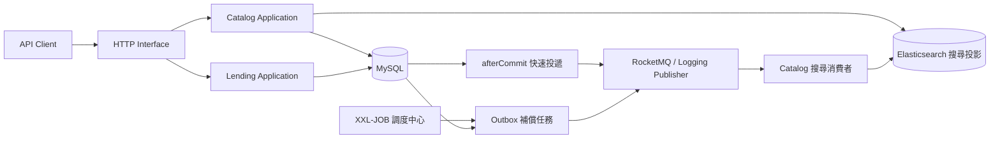

# E-Library 電子圖書館服務

[](https://github.com/ChovyCao2025/e-library-service/actions/workflows/ci.yml)


E-Library 是一個以 Java 21 與 Spring Boot 4 建立的電子圖書館後端範例。專案採用模組化單體與分層架構，實作書目瀏覽、借閱、歸還、持久化冪等、庫存與使用者配額控制，以及交易式 Outbox。

MySQL 保存全部權威業務狀態；借閱、歸還、庫存、配額、冪等結果與 Outbox 均在本地交易中維護。

> **範圍假設**
>
> 本專案將「瀏覽書籍」定義為瀏覽書目與中繼資料。題目將「瀏覽、借閱、閱讀」列為不同能力，而明確功能清單未要求正文交付，因此 PDF/EPUB 儲存、串流閱讀、下載與 DRM 不包含在本次實作範圍。

## 功能範圍

| 功能 | 狀態 | 說明 |
| --- | --- | --- |
| 瀏覽書籍 | 已完成 | 可選 Elasticsearch 書名前綴搜尋、分類、語言、格式篩選及 bookId 尋址分頁 |
| 查詢書籍詳細資料 | 已完成 | 書目資料、出版資訊與目前可借數量 |
| 借閱書籍 | 已完成 | 配額與庫存終裁、持久化冪等、同書重複借閱保護 |
| 歸還書籍 | 已完成 | 手動與到期歸還，共用冪等交易流程 |
| 查看目前借閱 | 已完成 | 依狀態查詢使用者借閱，支援 loanId 尋址分頁 |
| 管理書目與庫存 | 已完成 | 新增、樂觀鎖更新、上架、下架與調整借閱席位 |
| 數位內容閱讀 | 範圍外 | 後續可加入短效內容授權 URL 與獨立內容服務 |

## 架構概覽



- `catalog`：書目、中繼資料、上架狀態與管理操作。
- `lending`：借閱請求、權威庫存、使用者配額與 Loan。
- `shared`：錯誤模型、身分上下文、ID、設定與 Outbox。
- `application` 編排用例與交易，`domain` 保存領域型別，`infrastructure` 實作資料庫及外部系統，`interfaces` 提供 HTTP API。

完整說明請參閱 [架構文件](docs/architecture.md)、[API 文件](docs/api.md) 與
[效能基準](docs/performance/README.md)。

## 快速開始

### 環境需求

- JDK 21
- Docker 與 Docker Compose

### 啟動依賴

```bash
docker compose up -d mysql
```

啟用 Elasticsearch 搜尋及首次回填：

```powershell
docker compose --profile search up -d mysql elasticsearch
$env:SEARCH_ENABLED = "true"
$env:SEARCH_REBUILD_ON_STARTUP = "true"
.\mvnw.cmd spring-boot:run
```

回填完成後將 `SEARCH_REBUILD_ON_STARTUP` 設回 `false`。持續同步管理端書目異動時，同時啟動
RocketMQ，並設定 `ROCKETMQ_ENABLED=true` 與 `SEARCH_CONSUMER_ENABLED=true`：

```powershell
docker compose --profile search --profile mq up -d
```

### 啟動應用程式

Linux 或 macOS：

```bash
./mvnw spring-boot:run
```

Windows PowerShell：

```powershell
.\mvnw.cmd spring-boot:run
```

啟動後可使用：

- 書目 API：<http://localhost:8080/api/v1/books>
- Swagger UI：<http://localhost:8080/swagger-ui.html>
- 健康檢查：<http://localhost:8080/actuator/health>
- Prometheus 指標：<http://localhost:8080/actuator/prometheus>

Flyway 會自動建立資料表，並加入 100 本一般測試書籍及一本單席位熱點書籍 `2000001`。

## API 快速示例

瀏覽與查看書籍：

```bash
curl "http://localhost:8080/api/v1/books?size=2&language=en&format=EBOOK"
curl "http://localhost:8080/api/v1/books/2000001"
```

借閱書籍：

```bash
curl -i -X POST "http://localhost:8080/api/v1/loans" \
  -H "Content-Type: application/json" \
  -H "Idempotency-Key: demo-borrow-001" \
  -d '{"bookId":"2000001"}'
```

查詢與歸還：

```bash
curl "http://localhost:8080/api/v1/users/me/loans?status=BORROWED"
curl -X POST "http://localhost:8080/api/v1/loans/LOAN_ID/return"
```

業務 API 統一回傳 `200 OK`；首次借閱與冪等重放都回傳 `code: 0000`，重放另附帶 `Idempotent-Replay: true`。

開發模式預設使用者為 `10001`。可用下列受信任標頭模擬其他身分：

```text
X-User-Id: 10002
X-Role: ADMIN
```

正式環境由閘道完成驗證並重新注入身分標頭；服務不得直接信任外部使用者提供的同名標頭。

## 專案結構

```text
.
├── .github/workflows/ci.yml      # GitHub Actions 建置與測試
├── docs/
│   ├── architecture.md           # 架構、資料一致性與設計取捨
│   ├── api.md                    # HTTP API 與錯誤格式
│   └── design/                   # 設計文件版本歸檔
├── load-tests/k6-smoke.js        # k6 冒煙與熱點競爭情境
├── src/main/java/com/elibrary/
│   ├── catalog/                  # 書目邊界上下文
│   ├── lending/                  # 借閱邊界上下文
│   └── shared/                   # 共用技術能力
│       ├── kernel/               # 設定、時間與識別碼
│       ├── outbox/               # 交易式事件的領域、應用及基礎設施
│       └── web/                  # API、錯誤處理及可信身分
├── src/main/resources/
│   ├── db/migration/             # Flyway 版本化遷移
│   └── mybatis/                  # MyBatis XML SQL
├── src/test/                     # 單元、架構與 Testcontainers 測試
├── compose.yaml                  # 本地基礎設施
├── Dockerfile                    # 多階段應用映像
├── pom.xml
└── versions.lock                 # 已核對的工具與映像版本
```

## 核心工程決策

1. **模組化單體**：題目規模適合單一部署單元；依業務上下文分包，保留未來拆分邊界。
2. **MySQL 單一權威**：條件更新、資料列鎖、唯一鍵與 CHECK constraint 共同維護業務不變量。
3. **持久化冪等**：`(userId, Idempotency-Key)` 對應穩定 requestId 與 loanId，回應遺失後仍可安全重放。
4. **固定鎖順序**：借閱與歸還採相同資源鎖順序，降低死鎖循環風險。
5. **交易式 Outbox**：業務資料與事件共同提交；提交後立即非同步投遞，XXL-JOB 掃描遺漏與重試事件。
6. **MyBatis XML**：Mapper 介面只保存方法契約；SQL 採顯式欄位清單，並由架構測試禁止行內 SQL 註解。
7. **簡單尋址分頁**：書目與借閱列表直接使用上一頁最後一筆 ID，保留穩定分頁且避免額外協議複雜度。
8. **統一 API 回應**：業務端點一律回傳 `Resp<T>`，HTTP 傳輸狀態統一為 `200 OK`，呼叫端依 `code` 判斷業務結果。
9. **受控使用 Lombok**：只生成依賴注入構造器與存取方法；領域校驗、設定預設值及外部客戶端初始化仍使用顯式程式碼。
10. **可重建搜尋投影**：有 `q` 的書目搜尋使用 Elasticsearch；MySQL 保存權威書目與即時庫存，Outbox 事件按書目版本更新索引。

## 設定

常用環境變數記錄於 [.env.example](.env.example)。主要設定如下：

| 變數 | 預設值 | 用途 |
| --- | --- | --- |
| `DB_URL` | 本機 `elibrary` MySQL | JDBC 連線字串 |
| `DB_USERNAME` / `DB_PASSWORD` | `elibrary` | 資料庫帳號與密碼 |
| `APP_ROLE` | `all` | `api`、`worker` 或 `all` |
| `DEV_AUTH_ENABLED` | `true` | 啟用本機開發身分 |
| `ROCKETMQ_ENABLED` | `false` | 啟用 RocketMQ 發布器 |
| `SEARCH_ENABLED` | `false` | 將帶 `q` 的書目搜尋切換至 Elasticsearch |
| `SEARCH_REBUILD_ON_STARTUP` | `false` | 啟動時以 MySQL 全量回填版本化索引 |
| `SEARCH_CONSUMER_ENABLED` | `false` | 消費 Catalog MQ 事件並持續更新搜尋投影 |
| `SEARCH_BATCH_SIZE` | `5000` | 首次全量回填每批處理的書目數量 |
| `ELASTICSEARCH_URIS` | `http://localhost:9200` | Elasticsearch 節點位址 |
| `XXL_JOB_ENABLED` | `false` | 啟用 Outbox 補償執行器 |
| `XXL_JOB_ADMIN_ADDRESSES` | 本機 `8088` | XXL-JOB 調度中心位址 |

### Outbox 補償任務

正常路徑在業務交易提交後，透過有界執行緒池認領該筆事件並立即發布。執行緒池飽和、RocketMQ 發送失敗或程序中途終止時，事件仍保存在 MySQL；租約到期後可由補償任務重新認領。

生產或整合環境需部署 XXL-JOB 調度中心，設定 `XXL_JOB_ENABLED=true` 與調度中心位址，並建立以下任務：

| 設定 | 值 |
| --- | --- |
| 執行器 AppName | `e-library-outbox`，或 `XXL_JOB_EXECUTOR_APP_NAME` 的實際值 |
| JobHandler | `outboxCompensationJob` |
| 建議排程 | 每 5 秒一次，依積壓量與資料庫容量調整 |

執行器預設監聽 `9999`；容器或反向代理環境需讓調度中心可以存取該連接埠，並透過 `XXL_JOB_EXECUTOR_ADDRESS` 提供調度中心實際可達的位址。`APP_ROLE` 使用 `all` 或 `worker` 時才會執行補償。

直發與補償均先寫入唯一 owner 租約，並以 owner 條件確認 `SENT`，因此同一時刻只有一條路徑持有事件。發送成功後、狀態回寫前發生故障時仍可能重複投遞，下游消費者需以 `eventId` 去重。

## 建置與測試

```bash
./mvnw clean verify
```

測試分為：

- 單元測試：書目領域值物件、冪等鍵與 ID 產生器。
- 架構測試：領域層依賴規則，以及禁止 MyBatis 行內 SQL 註解。
- MySQL 整合測試：使用 Testcontainers 驗證借閱重放、售罄、重複歸還與計數不變量。
- 搜尋整合測試：使用真實 MySQL 與 Elasticsearch 驗證回填、前綴查詢、庫存組裝及外部版本幂等。
- 負載冒煙：`k6 run load-tests/k6-smoke.js`。

MySQL 與 Elasticsearch 整合測試需要可用的 Docker 環境，缺少 Docker 時會依 Testcontainers 設定跳過。

## 已知限制

- 數位正文、閱讀器、內容授權與 DRM 尚未實作。
- Elasticsearch 目前維持書名開頭比對語義；相關性、多語言分析器與模糊搜尋屬於後續搜尋能力。
- RocketMQ、XXL-JOB 聯合故障與積壓恢復仍需在完整基礎設施環境驗收。

## 參與開發

請先閱讀 [CONTRIBUTING.md](CONTRIBUTING.md)。本專案採用 [MIT License](LICENSE)。
