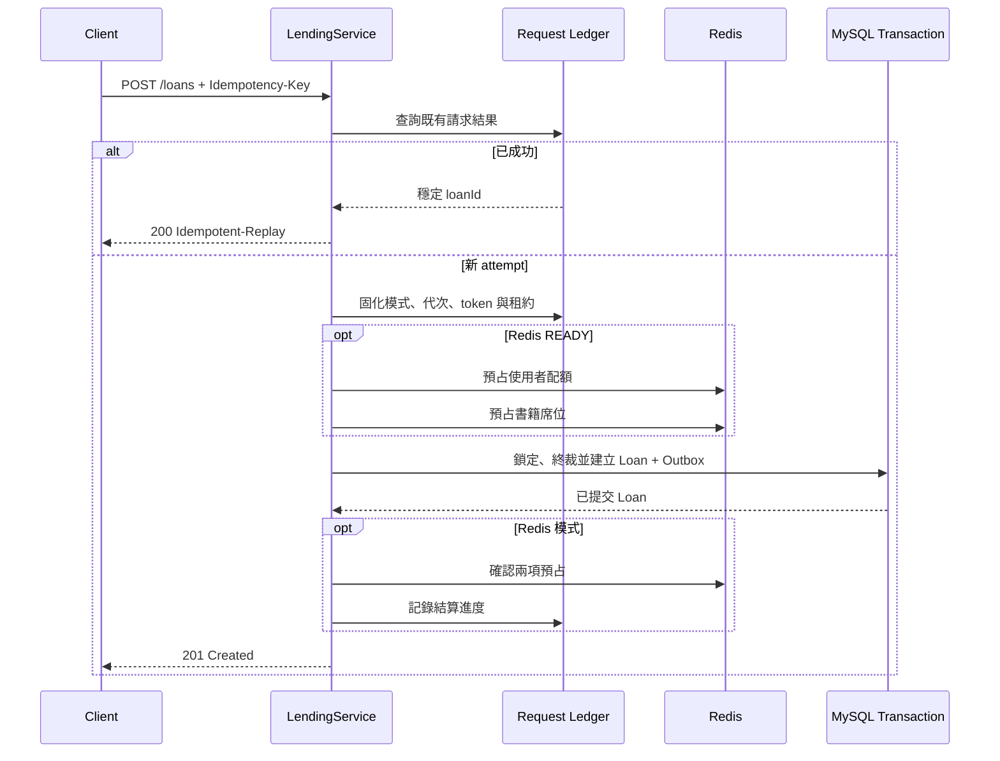

# 架構與設計取捨

## 1. 目標與邊界

本專案以面試題目要求的書目瀏覽、借閱、歸還與使用者借閱查詢為核心，設計目標依序為：

1. 在併發請求下維持庫存、使用者配額與活躍借閱唯一性。
2. 在回應遺失或請求重送時提供穩定的冪等結果。
3. 清楚區分權威資料與可重建投影。
4. 保持單一部署單元，避免在有限題目範圍內引入分散式交易。

數位正文儲存、閱讀器、DRM、計費、推薦與內容分發屬於後續邊界。

## 2. 架構風格

專案採用**分層的模組化單體**：

```text
com.elibrary
├── catalog
│   ├── interfaces       HTTP Controller 與 API DTO
│   ├── application      書目查詢及管理用例
│   ├── domain           書目領域型別
│   └── infrastructure   MyBatis Mapper 與資料列模型
├── lending
│   ├── interfaces       借閱 HTTP API 與 DTO
│   ├── application      借還編排、交易服務與外部連接埠
│   └── infrastructure   MyBatis、Redis 與背景 Worker
└── shared
    ├── kernel           ID、時間、雜湊與設定
    ├── outbox           交易式事件投遞
    └── web              身分、錯誤與簽章游標
```

這是一個務實分層，而非完全隔離的 Clean Architecture。Application 層目前直接使用 MyBatis persistence contract 與 Row model，以降低題目規模下的轉換樣板；Redis 則透過 `ReservationGateway` 隔離，因為它具有獨立協定、失敗語義與替換價值。若系統需要拆庫或支援多種資料來源，再將 MySQL Mapper 抽成 repository port。

## 3. 資料所有權

| 元件 | 職責 | 是否權威 |
| --- | --- | --- |
| MySQL | 書目、庫存、配額、借閱、冪等請求、Outbox | 是 |
| Redis | 配額與席位預占、可重建資源投影 | 否 |
| RocketMQ | 已提交事件的非同步傳遞 | 否 |
| Elasticsearch | 預留的書目搜尋投影 | 否，消費者尚未實作 |

借閱成功只由 MySQL 交易提交決定。Redis 的 `APPLIED` 代表准入預占成功，仍需通過資料庫的上架狀態、代次、條件計數與唯一鍵檢查。

## 4. 借閱流程



### 固定鎖順序

借閱交易依序鎖定：

```text
borrow_request
-> user projection_control
-> user_lending_account
-> book
-> book projection_control
-> lending_stock
```

歸還沿用相同資源順序，再鎖定 Loan。固定順序降低借閱、歸還與重建互相形成死鎖循環的機率；資料庫死鎖仍應視為可重試的交易失敗。

### 業務不變量

- 使用者活躍借閱數不得超過政策上限。
- 書籍可用席位介於 `0` 與總席位之間。
- 同一使用者對同一本書最多一筆 `BORROWED` Loan。
- 同一 `(userId, Idempotency-Key)` 只能對應一組業務參數與穩定結果。
- 歸還只有在 Loan 從 `BORROWED` 轉為 `RETURNED` 時才釋放配額與席位。

條件更新的影響行數、資料庫唯一鍵與 CHECK constraint 共同保護這些規則。

## 5. 冪等與恢復

`borrow_request` 是持久化請求臺帳，保存 requestId、loanId、請求指紋、attempt、token、租約、准入模式及 Redis 結算進度。

- 相同鍵與相同參數：回傳原本結果。
- 相同鍵與不同參數：回傳 `IDEMPOTENCY_KEY_REUSED`。
- 處理中的相同請求：回傳可重試的 `REQUEST_IN_PROGRESS`。
- attempt 逾期：先轉為 `RELEASING`，再執行可重送的 Redis 取消。
- 資料庫已提交但 Redis 確認失敗：保留成功 Loan，由 Worker 接續結算。

新的 attempt token 會隔離舊處理者；投影 generation 會隔離重建前的 Redis 命名空間。

## 6. Redis 投影

每個使用者與書籍都有獨立 `projection_control`：

- `READY`：Redis 投影可用，業務交易以共享鎖確認代次。
- `DIRTY`：DB_ONLY 路徑已修改權威狀態，需要重建。
- `REBUILDING`：Worker 以 owner 與租約認領，相關資源暫停 Redis 路徑。

Lua 腳本在單一 Redis Cluster hash slot 內原子維護計數、占用臺帳、待處理集合與取消標記。Redis 逾時回傳 `UNKNOWN`，因為逾時無法證明腳本未執行。

## 7. Outbox

聚合異動與 Outbox event 在同一 MySQL 交易內提交。Relay 使用 `FOR UPDATE SKIP LOCKED` 與租約分批認領，交易外呼叫訊息代理，再用短交易回寫 `SENT` 或下次重試時間。

這是至少一次投遞；事件可能在「已送出、尚未回寫」時重複，因此下游必須以 eventId 去重。

## 8. API 與錯誤

- 外部 ID 以 JSON 字串傳遞，避免 JavaScript 整數精度問題。
- 時間使用 UTC ISO-8601。
- 分頁採具 HMAC 的 seek cursor，避免深 offset 分頁。
- 錯誤統一使用 `application/problem+json`，包含穩定 `code`、`traceId`、`retryable` 及可選 requestId。
- 正式環境身分由受信任閘道注入；開發模式才接受預設模擬身分。

## 9. 主要取捨

| 決策 | 收益 | 成本 |
| --- | --- | --- |
| 模組化單體 | 交易簡單、部署直接、符合題目規模 | 無法獨立擴展上下文 |
| Redis 雙預占 | 提前拒絕售罄與超額請求 | 需要補償、代次與重建協定 |
| MySQL 最終裁決 | 正確性集中且可驗證 | 熱門書庫存列仍是序列化點 |
| 持久冪等臺帳 | 回應遺失後可安全重放 | 增加寫入與資料生命週期成本 |
| MyBatis XML | SQL 可審查、介面乾淨 | Java 與 XML 需要同步維護 |
| Outbox | 避免資料已提交但事件遺失 | 下游需處理重複事件 |

## 10. 後續演進

1. 加入內容授權服務，針對有效 Loan 簽發短效閱讀 URL。
2. 完成 Elasticsearch 消費者、PIT/search-after 與索引重建流程。
3. 在真實 Redis Cluster 驗證跨槽限制、故障轉移與資料重建。
4. 在 RocketMQ + Proxy 環境驗證發送回執、重複與重試。
5. 增加併發、故障注入及完整 HTTP 整合測試。
