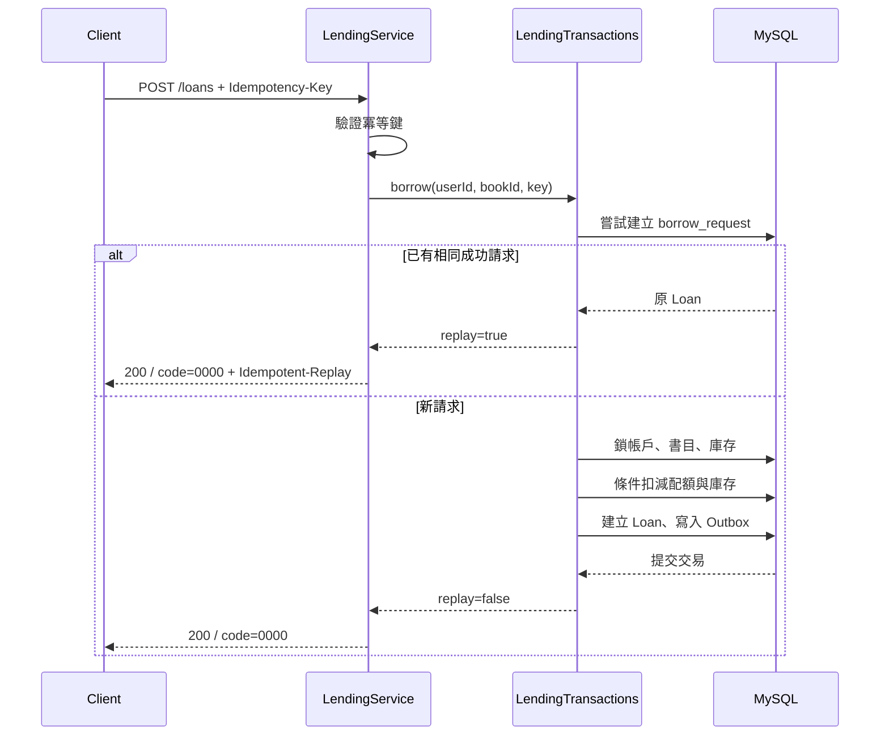

# 架構與設計取捨

## 1. 目標與邊界

本專案以面試題目要求的書目瀏覽、借閱、歸還與使用者借閱查詢為核心，設計目標依序為：

1. 在併發請求下維持庫存、使用者配額與活躍借閱唯一性。
2. 在回應遺失或請求重送時提供穩定的冪等結果。
3. 使用單一 MySQL 交易清楚表達業務一致性邊界。
4. 控制題目實作範圍，讓主要工程決策可以直接閱讀及測試。

數位正文儲存、閱讀器、DRM、計費、推薦與內容分發屬於後續邊界。

## 2. 架構風格

專案採用分層的模組化單體：

```text
com.elibrary
├── catalog
│   ├── interfaces       HTTP Controller 與 API DTO
│   ├── application      書目查詢及管理用例
│   ├── domain           書目領域型別
│   └── infrastructure   MyBatis Mapper 與資料列模型
├── lending
│   ├── interfaces       借閱 HTTP API 與 DTO
│   ├── application      借還用例與交易服務
│   ├── domain           借閱狀態與歸還原因
│   └── infrastructure   MyBatis Mapper、資料列模型與到期 Worker
└── shared
    ├── kernel           應用角色、設定、時間與識別碼
    ├── outbox
    │   ├── domain       事件、聚合與投遞狀態
    │   ├── application  Outbox 寫入、認領與投遞編排
    │   └── infrastructure  MyBatis、RocketMQ 與 XXL-JOB 適配
    └── web
        ├── api          統一回應、標頭與分頁約定
        ├── error        錯誤碼、例外與全域錯誤轉換
        └── security     可信身分與請求使用者上下文
```

這是一個務實分層。Application 層直接使用 MyBatis persistence contract 與 Row model，降低題目規模下的轉換樣板；領域值物件保存不依賴 HTTP 與持久化框架的書目規則。若後續需要拆庫或替換資料來源，再依實際變化方向抽出 repository port。

書目建立與容量調整由 `CatalogService` 編排本地交易；庫存資料與 `StockResized` 事件由 Lending 的 `LendingInventoryService` 管理。該服務使用 `MANDATORY` 交易傳播加入呼叫端交易，使書目與零庫存共同提交，同時維持 Lending 的資料所有權。

## 3. 資料所有權

| 元件 | 職責 | 是否權威 |
| --- | --- | --- |
| MySQL | 書目、庫存、使用者配額、借閱、冪等請求、Outbox | 是 |
| RocketMQ | 已提交事件的非同步傳遞 | 否 |

借閱成功只由 MySQL 交易提交決定。應用程式不維護第二份可寫庫存，也不需要快取重建、代次切換或跨資料源補償。

## 4. 借閱流程



### 固定鎖順序

借閱交易依序處理：

```text
borrow_request 唯一鍵
-> user_lending_account
-> book
-> lending_stock
-> loan 寫入
```

歸還交易依序鎖定：

```text
user_lending_account
-> book
-> lending_stock
-> loan
```

兩條流程對共同資源使用相同順序，降低死鎖循環機率。資料庫仍可能偵測並中止死鎖交易，正式環境應在入口層採用有界重試策略。

### 業務不變量

- 使用者活躍借閱數不得超過政策上限。
- 書籍可用席位介於 `0` 與總席位之間。
- 同一使用者對同一本書最多一筆 `BORROWED` Loan。
- 同一 `(userId, Idempotency-Key)` 只能對應一組業務參數與穩定結果。
- 歸還只有在 Loan 從 `BORROWED` 轉為 `RETURNED` 時才釋放配額與席位。

條件更新的影響行數、資料庫唯一鍵與 CHECK constraint 共同保護這些規則。任一步失敗都會回滾請求、計數、Loan 與 Outbox 事件。

## 5. 冪等與併發

`borrow_request` 保存 requestId、使用者、冪等鍵與書籍；`loan.request_id` 唯一關聯其成功結果。

- 相同鍵與相同書籍：回傳原本 Loan。
- 相同鍵改借其他書籍：回傳 `IDEMPOTENCY_KEY_REUSED`。
- 併發建立相同鍵：唯一鍵決定唯一寫入者，其他交易在寫入完成後讀取勝出結果。
- 借閱交易失敗：整筆交易回滾，不留下需要背景補償的半完成請求。

請求結果與 Loan 位於同一 MySQL 交易，因此回應遺失後，客戶端使用原 Idempotency-Key 重送命令即可取得已提交結果。

## 6. 庫存與容量調整

借閱使用條件更新扣減席位：

```sql
UPDATE lending_stock
SET available_copies = available_copies - 1,
    version = version + 1
WHERE book_id = :bookId
  AND available_copies > 0;
```

影響一行代表成功，影響零行回傳 `BOOK_SOLD_OUT`。同一本書的併發更新由 InnoDB 資料列鎖序列化。

容量調整維持 `已借出 = total_copies - available_copies`：

```text
newAvailable = oldAvailable + (newTotal - oldTotal)
```

`newAvailable < 0` 時拒絕調整，避免新總量低於目前有效借閱數。

## 7. Outbox

聚合異動與 Outbox event 在同一 MySQL 交易內提交。交易成功後，`afterCommit` 回呼只將 eventId 交給有界執行緒池；直發執行緒使用條件更新取得單筆 owner 租約，再於交易外呼叫訊息代理。佇列飽和時業務提交結果維持成功，事件維持 `NEW` 等待補償。

XXL-JOB 的 `outboxCompensationJob` 定期掃描到期的 `NEW` 事件與租約逾期的 `CLAIMED` 事件。補償批次使用 `FOR UPDATE SKIP LOCKED`，允許多個 Worker 分批處理。直發與補償共用發布及結果回寫服務，成功時以 owner 條件更新 `SENT`，失敗時以指數退避設定下一次嘗試時間。

這是至少一次投遞；事件可能在「已送出、尚未回寫」時重複，因此下游必須以 eventId 去重。

## 8. API 與錯誤

- 外部 ID 以 JSON 字串傳遞，避免 JavaScript 整數精度問題。
- 時間使用 UTC ISO-8601。
- 書目與借閱列表使用最後一筆 ID 進行尋址分頁，避免深 offset 掃描。
- 成功與錯誤統一使用 `Resp<T>` 的 `code`、`msg`、`data` 結構；錯誤 data 包含 `traceId`、`retryable` 及可選 requestId。
- 應用程式已處理的業務請求統一回傳 `200 OK`，呼叫端依 `code` 判斷業務結果。
- 正式環境身分由受信任閘道注入；開發模式才接受預設模擬身分。

## 9. 主要取捨

| 決策 | 收益 | 成本 |
| --- | --- | --- |
| 模組化單體 | 交易直接、部署簡單、符合題目規模 | 無法獨立擴展上下文 |
| MySQL 單一權威 | 一致性邊界清楚，無跨資料源補償 | 熱門書庫存列是序列化點 |
| 條件更新與唯一鍵 | 併發規則可由 SQL 和測試直接驗證 | 需要明確檢查影響行數與衝突 |
| 持久化冪等 | 回應遺失後可安全重放 | 增加請求資料生命週期管理 |
| MyBatis XML | SQL 可審查、介面乾淨 | Java 與 XML 需要同步維護 |
| Outbox + XXL-JOB 補償 | 避免資料已提交但事件遺失 | 下游需處理重複事件，部署需維護調度中心 |

## 10. 後續演進

1. 以正式流量資料觀察 `lending_stock` 與 `user_lending_account` 的鎖等待。
2. 只有在資料證明單列競爭成為瓶頸後，再比較排隊、分片或其他准入方案。
3. 加入內容授權服務，針對有效 Loan 簽發短效閱讀 URL。
4. 在 RocketMQ + Proxy 環境驗證發送回執、重複與重試。
5. 增加併發、死鎖重試、故障注入及完整 HTTP 整合測試。
