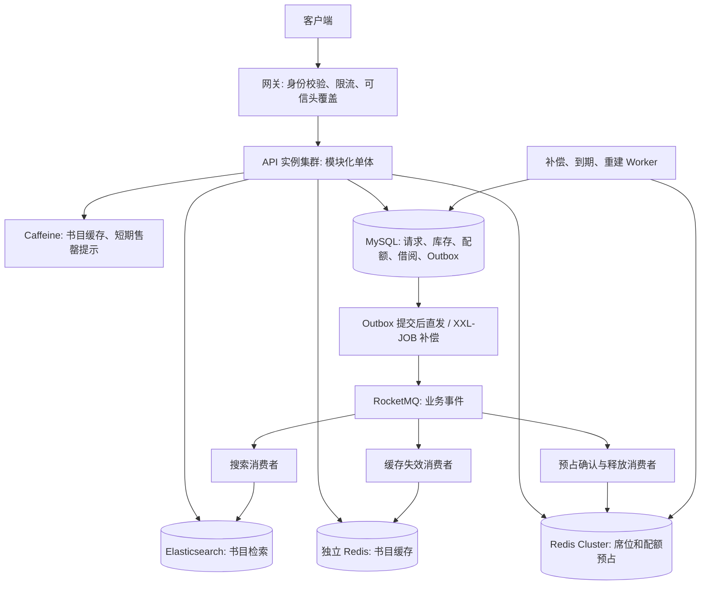
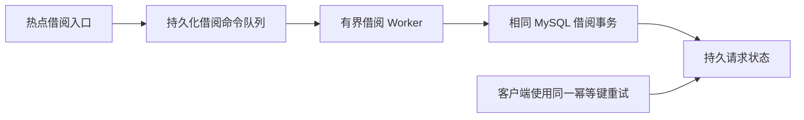

# E-Library 电子图书馆服务 · 后端设计与实施文档 v1.1 最终版

> 文档状态：设计与实施基线，尚待代码实现和验收。
> 核对日期：2026-11-19。
> 输入：原始作业 PDF（仅本地保存，未纳入公开仓库）、[v1.0 文档](e-library-backend-design-v1.0.md)及本会话确认的架构与修订意见。
> 已确认偏好：Java 21 LTS；保留 Redis 席位和用户配额双预占；MySQL 同步事务完成借还。
> 本文中的容量、延迟、可用性数字是验收目标或初始配置，实际结果以实现后的测试记录为准。

## 0. 使用说明与决策边界

本文作为 v1.1 的完整实施依据。v1.0 保留用于追溯；实施时以本文的状态机、SQL、事务边界和接口约定为准。

原作业明确要求浏览书籍、查询详情、借阅、归还、查看当前借阅，以及源代码和 README，预计用时为 4–6 小时。本企业版增加热点保护、到期回收、后台管理、搜索及故障恢复设计。企业版的完整实现与验证需单独排期，验收记录应分别说明作业核心功能和增强能力的完成情况。

本文区分四种内容：

| 标识 | 含义 |
| --- | --- |
| 原始要求 | PDF 明确要求的功能及交付物 |
| 本版决策 | 本项目选定的规则、架构与行为协议 |
| 部署前提 | 某项持久性、故障恢复或性能结论成立所需的环境 |
| 后续演进 | 当前实现之外、需要独立设计与验证的能力 |

默认实现范围包含书目管理、搜索、同步借还、双预占、到期回收、Outbox、补偿、降级、指标和测试。身份签发、正文阅读器、DRM、续借、预约、计费和推荐属于后续演进。

## 1. 业务模型与正确性目标

### 1.1 统一业务模型

一本电子书有若干同质的并发借阅席位。借出占用一个席位，归还或到期回收释放一个席位。其有限资源分配问题与电商库存扣减可以采用同类事务机制。

- 每个用户同时最多借 5 本，同一本书同时最多持有一条有效借阅。
- 默认借期 14 天，在借阅成功时固化 `dueAt`；配置变更影响后续借阅。
- 书目状态为 `DRAFT / PUBLISHED / OFFLINE`，上架后可新增借阅。
- 下架停止新增借阅，已有借阅允许查看和归还。
- 借阅状态为 `BORROWED / RETURNED`，归还原因区分 `MANUAL / EXPIRED`。
- 正文访问权限截止于 `dueAt`；席位和配额在归还事务提交时释放。到期任务延迟期间可能存在暂占，应监控并展示明确的业务提示。
- 所有时间由 `ClockProvider` 提供，内部采用 `Instant`，接口采用 UTC ISO-8601，数据库连接时区固定为 UTC。

### 1.2 权威数据与不变量

MySQL 保存库存、借阅、配额、请求结果和业务事件。Redis 保存可重建的预占与缓存；ES 保存可重建的书目检索投影。

在已提交数据库状态中必须成立：

```text
0 <= available_copies <= total_copies
available_copies = total_copies - COUNT(status = BORROWED 的该书借阅)
user.active_count = COUNT(status = BORROWED 的该用户借阅)
同一用户、同一本书最多一条 BORROWED 记录
同一用户、同一幂等键最多对应一次成功借阅
同一次借阅最多释放一次数据库库存与配额
```

用户上限降低时，已有借阅保留，新借阅按新上限判断。到期但尚未回收的记录仍计入上述 `BORROWED` 数量。

Redis 预占值与数据库值允许暂时偏离。数据库条件更新和唯一约束提供最终业务保护；Redis 偏差可能导致误拒、额外数据库尝试或短期展示滞后，需要补偿及重建处理。

## 2. 技术版本与维护策略

### 2.1 已核对的应用基线

用户选择稳定的 Java 21 LTS 功能版本，同一 LTS 系列持续接收安全补丁。版本兼容声明与项目实际集成测试分别记录。

| 组件 | v1.1 选择 | 核对依据与使用约定 |
| --- | --- | --- |
| JDK | Eclipse Temurin Java 21 LTS | Adoptium 查询当日返回 `jdk-21.0.13.1+2`；构建与运行固定同一批准补丁，后续在 21 系列更新 |
| Spring Boot | `4.0.9` GA | 官方 4.0 系统要求包含 Java 21；选用已发布的 4.0 维护线 |
| MyBatis Starter | `4.0.1` | 官方兼容表中 4.0 系列对应 Boot 4.0+；Maven Central 存在该制品 |
| MapStruct | `1.6.3` | 使用正式版，运行依赖与注解处理器使用相同版本 |
| Lombok | `1.18.48` | 仅生成构造器及访问器，不使用 `@Data` 隐式引入对象相等与字符串输出语义 |
| springdoc | `3.0.3` | 官方矩阵中 Boot 4.0.x 对应 springdoc 3.0.x；Central 存在该制品 |
| RocketMQ Java SDK | `5.2.1` | 使用官方 `rocketmq-client-java`，通过项目端口接入，避免绑定未经验证的 Boot Starter |
| XXL-JOB Core | `3.5.0` | 执行器接入调度中心，仅用于 Outbox 遗漏及失败事件补偿 |
| HikariCP、Lettuce、Caffeine、Micrometer、Jackson | Boot BOM 管理 | 导出实际 dependency tree；对显式覆盖的依赖记录原因和测试 |
| 数据迁移与测试 | Flyway、Testcontainers、ArchUnit、k6 | 由 M0 锁定与 Boot 基线匹配的正式版本，并完成冒烟验证 |

Spring 官方代际 API 在核对日列出 Boot 4.0.x 的开源维护截止日期为 **2026-12-31**。本基线用于当前开发；生产发布门禁检查发布日期是否仍在维护期。接近或超过该日期时，升级到当时受支持的 4.x 维护线并重新执行依赖回归。Boot 3.3.x 已结束开源支持，v1.1 更新原文的该项选型。

### 2.2 服务端基线与版本锁定

| 组件 | 选择的版本线 | 决策 |
| --- | --- | --- |
| MySQL | 8.4 LTS | 采用 LTS 线，继承原文的 InnoDB、条件更新和显式 SQL 方案 |
| Redis | 7.4 | 生产采用 Cluster；缓存和预占使用独立部署资源 |
| Elasticsearch | 8.19 | Java API Client 固定相同 8.x 兼容线，避免由 Boot 自动带入另一主版本客户端 |
| RocketMQ | 5.x | 包含 SDK 所需 Proxy；开发参考官方 5.3.2 快速开始，生产补丁另经安全与兼容审核 |

上表中的服务端版本线属于选型范围，尚未对应已经部署并测试的镜像。M0 必须生成 `versions.lock`，固定每个镜像的补丁版本、digest、客户端版本、中文分词插件版本和校验日期。部署脚本读取该文件；升级通过变更请求和冒烟测试完成。

中文分词保留 IK 方案，ES 与插件版本严格配套。M0 以真实插件启动、建索引和中文查询验证为发布门禁；版本无法配套时先提交新的 ADR，再修改分词实现。

### 2.3 维护事实与集成验证

官方声明能确认版本存在、兼容范围或维护日期。本项目的启动、事务、序列化、指标、SDK 和插件组合，需要实际测试确认。本文不将依赖坐标存在等同于整套集成已经通过。

## 3. 总体架构与模块边界

### 3.1 本版部署与数据流



借还成功以数据库事务提交为准。RocketMQ 在本版承担事务后事件传递，消费者按事件类型与独立消费组订阅。异步借阅请求队列列在第 12 节演进架构中。

### 3.2 模块职责

| 模块 | 职责与拥有的数据 |
| --- | --- |
| catalog | 书目、分类、上下架、书目版本、书目事件 |
| lending | 库存、配额、借阅、幂等请求、资源预占及恢复 |
| search | 搜索、索引同步与重建任务 |
| admin.application | 调用业务门面编排管理员用例，声明同库事务 |
| shared | ID、时间、错误、追踪、可信用户上下文、Outbox 通用机制 |

采用六边形边界：domain 表达规则和不变量；application 编排用例及事务；infrastructure 实现 SQL、Redis、MQ、ES 端口；interfaces 处理 HTTP 参数和响应。

上下文间调用 application facade 或 port。v1.1 在同一 MySQL 数据源中，由应用服务协调必要的本地事务。拆分服务或数据库将改变事务条件，届时单独设计一致性协议。

同一镜像通过 `app.role=api|worker|all` 分角色启动。API 可水平扩展，Worker 按任务租约、消费组和并发预算扩展。

### 3.3 身份与权限边界

- 网关验证 JWT，并清除客户端提供的 `X-User-Id`、`X-Role` 后重新设置可信值。
- 后端入口由网络策略和服务间认证限制为可信网关，管理员接口同时校验管理员角色。
- 借阅资源操作始终带当前 `userId`；资源不存在或属于其他用户时统一返回 404。
- 本地开发可通过显式 `dev` 配置模拟用户；生产启动门禁拒绝开发身份模式。
- 网关认证、后端资源归属检查、管理员操作审计分别落实，身份头不是独立的安全凭证。

## 4. 领域、请求和投影状态机

### 4.1 核心领域对象

| 对象 | 关键行为 |
| --- | --- |
| Book | 创建、修改、上下架；每次变更增加版本并产生完整书目快照事件 |
| LendingStock | 条件借出、归还、调整容量；保证余量范围 |
| UserLendingAccount | 条件占用及释放用户额度 |
| Loan | 成功借阅、主动归还、到期归还；记录借期与归还原因 |
| BorrowPolicy | 默认最大在借 5、借期 14 天；配置版本随成功借阅记录固化 |

### 4.2 持久借阅请求

请求以 `(userId, idemKey)` 唯一定位，保存固定的 `bookId` 与 `requestId`；Loan 通过唯一的 `requestId` 关联。请求记录、Loan、库存、配额和 Outbox 位于同一 MySQL 事务；成功时共同提交，失败时整体回滚，不持久化中间状态。

相同键与相同 `bookId` 返回原 Loan；同一键改借其他书籍时返回 `IDEMPOTENCY_KEY_REUSED`。借阅归档和幂等记录清理属于后续数据生命周期设计，实施时须保留既有重放语义。

### 4.3 资源投影控制

每本书、每个用户分别有一个 `projection_control`，保存 `generation`、`READY / DIRTY / REBUILDING`、重建租约。DIRTY 表示数据库路径已修改资源，Redis 投影待重建。

借阅 attempt 固化两种资源代次；数据库借还事务锁定控制行并检查其状态。旧代次 attempt 在新代次启用后也无法迟到提交。

重建只暂停目标资源相关的新写事务，其他书籍和用户继续服务。相关请求收到可重试的 503；已成功请求的幂等重放仍可返回。

## 5. MySQL 表结构基线

统一 InnoDB、UTC `DATETIME(3)`、正数 63 位 Snowflake ID、`READ COMMITTED`。API 中所有 ID 输出字符串。以下 DDL 是 Flyway 初始迁移的规范，所有新增时间值由统一时钟传入。

```sql
CREATE TABLE category (
  category_id BIGINT UNSIGNED NOT NULL PRIMARY KEY,
  name VARCHAR(50) NOT NULL,
  parent_id BIGINT UNSIGNED NOT NULL DEFAULT 0
) ENGINE=InnoDB DEFAULT CHARSET=utf8mb4;

CREATE TABLE book (
  book_id BIGINT UNSIGNED NOT NULL PRIMARY KEY,
  isbn VARCHAR(20) NULL,
  title VARCHAR(200) NOT NULL,
  subtitle VARCHAR(200) NULL,
  authors JSON NOT NULL,
  publisher VARCHAR(100) NULL,
  category_id BIGINT UNSIGNED NOT NULL,
  language VARCHAR(10) NOT NULL,
  description TEXT NULL,
  cover_url VARCHAR(500) NULL,
  published_date DATE NULL,
  format VARCHAR(10) NOT NULL,
  status VARCHAR(10) NOT NULL,
  version BIGINT NOT NULL DEFAULT 1,
  created_at DATETIME(3) NOT NULL,
  updated_at DATETIME(3) NOT NULL,
  UNIQUE KEY uk_book_isbn (isbn),
  KEY idx_book_category_status (category_id, status, book_id),
  KEY idx_book_status_id (status, book_id),
  CONSTRAINT ck_book_status CHECK (status IN ('DRAFT','PUBLISHED','OFFLINE')),
  CONSTRAINT ck_book_format CHECK (format IN ('EBOOK','JOURNAL'))
) ENGINE=InnoDB DEFAULT CHARSET=utf8mb4;

CREATE TABLE lending_stock (
  book_id BIGINT UNSIGNED NOT NULL PRIMARY KEY,
  total_copies INT NOT NULL DEFAULT 0,
  available_copies INT NOT NULL DEFAULT 0,
  version BIGINT NOT NULL DEFAULT 0,
  updated_at DATETIME(3) NOT NULL,
  CONSTRAINT ck_stock CHECK (
    total_copies BETWEEN 0 AND 100000
    AND available_copies BETWEEN 0 AND total_copies
  )
) ENGINE=InnoDB DEFAULT CHARSET=utf8mb4;

CREATE TABLE user_lending_account (
  user_id BIGINT UNSIGNED NOT NULL PRIMARY KEY,
  active_count INT NOT NULL DEFAULT 0,
  version BIGINT NOT NULL DEFAULT 0,
  updated_at DATETIME(3) NOT NULL,
  CONSTRAINT ck_account_count CHECK (active_count >= 0)
) ENGINE=InnoDB DEFAULT CHARSET=utf8mb4;

CREATE TABLE projection_control (
  resource_type VARCHAR(4) CHARACTER SET ascii COLLATE ascii_bin NOT NULL,
  resource_id BIGINT UNSIGNED NOT NULL,
  generation BIGINT NOT NULL DEFAULT 1,
  state VARCHAR(12) NOT NULL DEFAULT 'REBUILDING',
  owner_token VARCHAR(80) NULL,
  lease_until DATETIME(3) NULL,
  updated_at DATETIME(3) NOT NULL,
  PRIMARY KEY (resource_type, resource_id),
  KEY idx_projection_rebuild (state, lease_until),
  CONSTRAINT ck_projection_type CHECK (resource_type IN ('BOOK','USER')),
  CONSTRAINT ck_projection_state CHECK (state IN ('READY','DIRTY','REBUILDING'))
) ENGINE=InnoDB DEFAULT CHARSET=utf8mb4;

CREATE TABLE borrow_request (
  request_id BIGINT UNSIGNED NOT NULL PRIMARY KEY,
  user_id BIGINT UNSIGNED NOT NULL,
  idem_key VARCHAR(64) CHARACTER SET ascii COLLATE ascii_bin NOT NULL,
  book_id BIGINT UNSIGNED NOT NULL,
  created_at DATETIME(3) NOT NULL,
  UNIQUE KEY uk_request_user_idem (user_id, idem_key)
) ENGINE=InnoDB DEFAULT CHARSET=utf8mb4;

CREATE TABLE loan (
  loan_id BIGINT UNSIGNED NOT NULL PRIMARY KEY,
  request_id BIGINT UNSIGNED NOT NULL,
  user_id BIGINT UNSIGNED NOT NULL,
  book_id BIGINT UNSIGNED NOT NULL,
  status VARCHAR(10) NOT NULL,
  active_key TINYINT GENERATED ALWAYS AS (
    CASE WHEN status = 'BORROWED' THEN 1 ELSE NULL END
  ) STORED,
  borrowed_at DATETIME(3) NOT NULL,
  due_at DATETIME(3) NOT NULL,
  returned_at DATETIME(3) NULL,
  return_reason VARCHAR(10) NULL,
  policy_version VARCHAR(32) NOT NULL,
  version BIGINT NOT NULL DEFAULT 0,
  created_at DATETIME(3) NOT NULL,
  updated_at DATETIME(3) NOT NULL,
  UNIQUE KEY uk_loan_request (request_id),
  UNIQUE KEY uk_user_book_active (user_id, book_id, active_key),
  KEY idx_user_status_id (user_id, status, loan_id),
  KEY idx_book_active (book_id, active_key, loan_id),
  KEY idx_status_due (status, due_at, loan_id),
  CONSTRAINT ck_loan_status CHECK (status IN ('BORROWED','RETURNED')),
  CONSTRAINT ck_loan_dates CHECK (due_at > borrowed_at),
  CONSTRAINT ck_loan_return CHECK (
    (status = 'BORROWED' AND returned_at IS NULL AND return_reason IS NULL)
    OR (status = 'RETURNED' AND returned_at IS NOT NULL
        AND return_reason IS NOT NULL AND return_reason IN ('MANUAL','EXPIRED'))
  )
) ENGINE=InnoDB DEFAULT CHARSET=utf8mb4;

CREATE TABLE outbox_event (
  id BIGINT UNSIGNED NOT NULL PRIMARY KEY,
  aggregate_type VARCHAR(30) NOT NULL,
  aggregate_id BIGINT UNSIGNED NOT NULL,
  event_type VARCHAR(50) NOT NULL,
  aggregate_version BIGINT NOT NULL,
  payload JSON NOT NULL,
  status VARCHAR(12) NOT NULL DEFAULT 'NEW',
  owner_token VARCHAR(80) NULL,
  lease_until DATETIME(3) NULL,
  next_attempt_at DATETIME(3) NOT NULL,
  attempts INT NOT NULL DEFAULT 0,
  created_at DATETIME(3) NOT NULL,
  sent_at DATETIME(3) NULL,
  last_error VARCHAR(1000) NULL,
  KEY idx_outbox_ready (status, next_attempt_at, id),
  KEY idx_outbox_lease (status, lease_until, id)
) ENGINE=InnoDB DEFAULT CHARSET=utf8mb4;

CREATE TABLE consumer_receipt (
  consumer_group VARCHAR(64) CHARACTER SET ascii COLLATE ascii_bin NOT NULL,
  target_key VARCHAR(128) CHARACTER SET ascii COLLATE ascii_bin NOT NULL,
  event_id BIGINT UNSIGNED NOT NULL,
  status VARCHAR(16) NOT NULL,
  attempts INT NOT NULL DEFAULT 0,
  last_error VARCHAR(1000) NULL,
  applied_at DATETIME(3) NULL,
  updated_at DATETIME(3) NOT NULL,
  PRIMARY KEY (consumer_group, target_key, event_id),
  KEY idx_receipt_status (status, updated_at)
) ENGINE=InnoDB DEFAULT CHARSET=utf8mb4;
```

`consumer_receipt.status` 采用 `PENDING / APPLIED / SUPERSEDED / FAILED`。任务重试通过按目标分配的消费队列或任务租约串行认领；Redis/ES 的副作用本身也必须幂等。

v1.1 采用应用层关联校验，数据库使用唯一约束和 CHECK 保护核心不变量。所有归属查询带 `userId`；将来分片会使用户配额、书籍库存及借阅跨分片，需另写事务 ADR。

## 6. 事务与关键 SQL

### 6.1 统一锁顺序

```text
借阅：request -> USER projection -> account -> book(SHARE)
      -> BOOK projection -> stock -> loan -> outbox
归还：USER projection -> account -> book(SHARE)
      -> BOOK projection -> stock -> loan -> outbox
上下架：catalog gate(SHARE) -> book(UPDATE) -> outbox / search delivery
调库存：book(SHARE) -> BOOK projection -> stock -> outbox
```

归还预读 `(userId, loanId)` 获取不可变的 `bookId`，随后进入事务按上述顺序锁定并重新读取状态。正常 Redis 路径的投影控制行以共享锁读取并持有到提交；DB_ONLY 从开始取得排他锁，以便标记 DIRTY，具体见 8.5。重建状态变更使用排他锁。

书目状态经 `BookCatalogGateway.lockSnapshot()` 在同一数据库事务中读取 `FOR SHARE`，缓存仅提供前置提示。借阅检查 `PUBLISHED`，归还允许任一书目状态。新建书通过管理员应用编排器在同一本地事务中创建书目、零库存和书籍投影控制行。

### 6.2 借阅终裁

以下命名参数表示 MyBatis 绑定参数，执行时使用参数化 SQL。

```sql
UPDATE user_lending_account
SET active_count = active_count + 1,
    version = version + 1, updated_at = :now
WHERE user_id = :userId AND active_count < :maxActive;

UPDATE lending_stock
SET available_copies = available_copies - 1,
    version = version + 1, updated_at = :now
WHERE book_id = :bookId AND available_copies > 0;
```

每条更新必须影响一行，然后插入 `loan`、更新请求为 `SUCCEEDED`、插入 `BookBorrowed` Outbox，整体提交。任一步骤失败则整体回滚。上架状态和资源代次检查由同一事务中已持有的锁保护。

账户和投影控制行在请求初始化阶段以短事务幂等创建。数据库唯一约束处理并发重借和请求重复；唯一冲突后先回滚整个事务，再按冲突约束及主库记录分类返回。

### 6.3 归还与到期

```sql
UPDATE loan
SET status = 'RETURNED', returned_at = :now,
    return_reason = :reason, version = version + 1, updated_at = :now
WHERE loan_id = :loanId AND user_id = :userId AND status = 'BORROWED';

UPDATE user_lending_account
SET active_count = active_count - 1,
    version = version + 1, updated_at = :now
WHERE user_id = :userId AND active_count > 0;

UPDATE lending_stock
SET available_copies = available_copies + 1,
    version = version + 1, updated_at = :now
WHERE book_id = :bookId AND available_copies < total_copies;
```

执行上述语句前，按 6.1 锁定账户、库存和借阅。第一条影响零行时重新确认归属及状态，已归还则直接返回成功；后两条仅在本次状态迁移成功时执行。释放更新影响零行视为不变量异常，整笔回滚并告警。

同事务写入 `BookReturned`，包含当前资源代次、资源版本和稳定 `loanId`。事务提交后的快速 Redis 释放与 MQ 兜底消费采用同一协议。

到期任务每 30 秒按 `(status, due_at, loan_id)` 扫描 500 条，调用相同归还用例。多 Worker 可以重复选中记录，幂等事务保证一次迁移；每个 Worker 使用有界并发和独立任务预算。

### 6.4 修正后的容量调整

```sql
UPDATE lending_stock
SET available_copies = available_copies + (:newTotal - total_copies),
    total_copies = :newTotal,
    version = version + 1,
    updated_at = :now
WHERE book_id = :bookId
  AND :newTotal BETWEEN 0 AND 100000
  AND available_copies + (:newTotal - total_copies) >= 0;
```

先基于旧总数计算余量，再更新总数。调整事务锁定书籍投影控制和库存，增加资源代次并置 `REBUILDING`，写 `StockResized` 事件；提交后触发第 8 节重建。

示例推演：总数 10、可借 3，调整到 20 后可借 13；调整到 6 会因已有 7 条有效借阅而拒绝。该示例为设计推演，实际 SQL 由集成测试验证。

### 6.5 事务运行约束

application 层声明事务；事务体只执行当前 MySQL 数据源的操作。Redis、MQ、ES、HTTP、等待和退避位于事务之外。

数据库错误 1213/1205 在确认回滚整个事务后最多重试 2 次，间隔随机 10–30ms，并复用请求和 attempt。事务超时初值 3 秒，应用处理租约初值 30 秒。JDBC 超时或连接中断统一进入结果裁决，不能单凭超时推断回滚完成。

## 7. Redis 双预占协议

### 7.1 Key 与原子边界

用户和书籍分别使用 hash tag，每个 Lua 的全部键属于一个 tag。两种资源分别执行，不声明跨槽原子性。

| 资源 | Key 示例 | 内容 |
| --- | --- | --- |
| 书籍 | `{b:123}:g4:meta` | READY、数据库快照版本、代次 |
| 书籍 | `{b:123}:g4:available` | 扣除预占后的展示及准入余量 |
| 书籍 | `{b:123}:g4:occupied` | HASH：loanId -> userId、token、PENDING/COMMITTED |
| 书籍 | `{b:123}:g4:user-loan` | HASH：userId -> loanId，用于前置重复借阅提示 |
| 书籍 | `{b:123}:g4:pending` | ZSET：token、loanId、到期时间 |
| 用户 | `{u:456}:g2:meta` | READY、数据库快照版本、代次 |
| 用户 | `{u:456}:g2:count` | 提交占用与临时预占合计 |
| 用户 | `{u:456}:g2:occupied` | HASH：loanId -> token、PENDING/COMMITTED |
| 用户 | `{u:456}:g2:pending` | ZSET：token、loanId、到期时间 |
| 用户 | `{u:456}:g2:idem:<hash>` | requestId、loanId、bookId、attempt 的加速映射 |
| 两种资源 | 对应 tag 下的 `cancel:<token>` | 取消标记，拦截迟到的同 token 预占 |

RedisKeys 统一构造键名；用户与书籍 ID 使用十进制字符串。幂等键在缓存键中使用摘要，原始键仍由数据库持久校验。

预占集群采用 `noeviction`，书目缓存采用独立资源。当前代次的资源结构由控制协议清理，保持相同生命周期；取消标记保留 7 天，旧代次命名空间在失效并处理在途请求后设置 7 天清理 TTL。超过保留窗口的历史事件走主库核验及重建，采用当前代次快照恢复。

### 7.2 Lua 端口契约

开发时以以下协议实现脚本和集成测试；本节是状态协议，脚本需逐项覆盖全部返回分支。

| 操作 | 原子行为 |
| --- | --- |
| `reserveQuota` | 检查代次 READY 和取消标记；同 token 重复调用返回原预占；检查额度，新增 occupied/pending 并增加 count |
| `reserveStock` | 检查代次 READY、取消标记、同用户借阅及余量；建立本 token 占用、pending 和 user-loan，扣减 available |
| `confirmReservation` | 仅将对应 token 的 PENDING 改为 COMMITTED 并移除 pending；数量保持原值 |
| `cancelReservation` | 写取消标记；仅删除匹配 token 的 PENDING 占用并逆转其数量；按值比较清理幂等映射 |
| `releaseCommittedLoan` | 仅在本代次确实存在该 loanId 的占用时移除并回补；user-loan 只在值仍为该 loanId 时删除 |

脚本修改数量的依据是“本次移除了一个实际存在的占用”，同时维护标量和占用账本。重复事件、迟到确认和旧借阅释放返回幂等结果。新代次快照已经包含的状态，通过快照数据库版本及占用记录识别，避免再次回补。

资源记录中携带 token、loanId 和代次，释放旧借阅时保护同一用户后续的新借阅。脚本先验证键类型、元数据和参数，随后执行写入；Redis 脚本原子执行不等同于脚本运行错误时自动回滚已执行写入。

### 7.3 执行顺序与客户端约束

```text
持久幂等重放 -> 初始化/认领请求 attempt -> 获取两种资源代次
-> 预占用户配额 -> 预占书籍席位 -> 数据库借阅事务
-> 确认两个 Redis 占用 -> 返回借阅结果
```

写脚本采用 100ms 初始超时，禁止客户端透明重试。结果未知时保留对应请求和资源信息，由裁决流程处理；重试相同 token 的行为由端口协议明确控制。

Redis Cluster 的批量查询由客户端按槽拆批、合并结果；Lua 始终只访问同槽键。`SCRIPT LOAD / EVALSHA` 处理脚本缓存失效时，只在确认 `NOSCRIPT` 后重新装载并执行。

本地售罄提示 TTL 初值 500ms，只在完成幂等重放检查后用于新尝试。它可以短期误拒；归还和代次变化会清除相关实例提示，TTL 提供遗漏通知后的收敛边界。

## 8. 请求裁决、补偿与资源重建

### 8.1 借阅完整流程

下述步骤描述 REDIS 准入模式。DB_ONLY 在认领 attempt 时选定，跳过两段 Lua，采用 8.5 的资源控制和同一数据库业务规则。

1. 完成认证、入口限流及格式校验，按 `(userId, idemKey)` 读取主库请求记录。
2. 参数不匹配返回 422；成功则返回原 loanId 对应的当前借阅，附重放头；有效处理中返回 409 和 Retry-After。
3. 对新请求创建台账，对已补偿完成请求以 CAS 启动新 attempt；固化 owner token、租约、loanId 和资源代次。
4. 依次执行配额和席位预占。任一拒绝，将请求转入 RELEASING，按令牌补偿已经执行或结果未知的资源。
5. 执行借阅事务：锁定请求，确认 attempt/租约；按第 6 节加锁并检查资源 READY、代次和上架状态；修改账户、库存、Loan、请求成功状态和 Outbox。
6. 提交成功后确认两段预占；确认失败记录待修复状态，由成功事件与补偿扫描收敛，HTTP 仍按数据库成功结果响应。
7. 明确失败且整个事务已回滚时补偿。提交结果未知时，保留预占，返回含 requestId 的 503，由主库裁决或同幂等键重试查询结果。

仅通过缓存得到的售罄、额度不足、已借阅属于准入结果；数据库用同一组规则防止实际违规写入。

### 8.2 裁决与防止迟到提交

补偿 Worker 扫描 `PROCESSING` 租约到期、`RELEASING` 和成功但预占尚未结算的请求。

- 对超时请求先在数据库事务中锁住 request 行。借阅事务持有该锁时，裁决者等待其结束，再读取已提交结果。
- `SUCCEEDED`：核对 Loan 当前状态；仍在借则确认占用，已归还则按当前代次释放或由重建收敛。
- `PROCESSING` 且租约到期：将其变为 RELEASING，提交后执行 Redis 取消。迟到的借阅处理者再次获得请求锁时将无法通过 attempt 状态检查。
- Redis 查询或释放结果未知：保持 RELEASING 并重试；已被新代次作废的旧命名空间视为已结算。
- 两段资源均结算后变为 RETRYABLE，随后相同参数可启动新 attempt。
- MySQL 不可访问：保留当前状态，等待数据库恢复后裁决。

30 秒是处理租约初值；实际回收时间还包含扫描间隔、锁等待及依赖恢复时间，监控其积压年龄。

### 8.3 资源重建协议

单本书或单个用户的重建采用以下步骤：

1. 短事务锁定投影控制行，等待已持有共享锁的业务事务结束；代次加一，置 REBUILDING，写入重建 owner 和租约。
2. 事务提交后，新旧业务处理者均受到资源状态和代次检查约束。旧 attempt 最终进入补偿，新请求收到可重试提示。
3. 从主库读取资源数量、版本和所有对应的 BORROWED loanId。该资源写入在此阶段被控制行状态暂停。
4. 在新 Redis 命名空间分批写入快照，建立数量、occupied、user-loan 等结构；所有网络操作在数据库事务之外。
5. 校验快照和账本后设置 Redis READY；短事务按 owner、代次 CAS 将数据库控制行改为 READY，恢复相关请求。
6. 旧代次后台清理；旧事件只能处理其代次，并根据当前主库状态决定结束或触发当前代次重建。

重建者失联后，由新 Worker 通过租约认领并继续同一代次或增加代次重做。旧 Worker 的收尾 CAS 失效。新资源尚无 owner 或 lease 的 REBUILDING 行也属于可认领任务。

当前代次键缺失、类型异常或账本不完整时，整体进入资源重建。线上对账先核实未结算请求和版本，再通过此协议修复。静止状态对账要求数据库与 Redis 的数量、占用身份均一致。

### 8.4 故障恢复与 canary 边界

canary 用作探测键丢失的辅助信号。它能发现某些清空、重启或键丢失情形；后续部分写回退可能保留 canary，因此同时监测 Redis 连接、集群拓扑变化、主库拒绝率和周期对账。

Redis 恢复后，受影响资源先进入受限恢复模式。重建失败保持可重试状态并告警。恢复验证在停止新请求、完成在途请求和补偿后执行；持续并发期间使用带版本和 pending 解释的差异指标。

### 8.5 DB-only 路径及重新接入

- `admission_mode` 在 attempt 启动时固定。Redis 预占进行中的 attempt 先完成裁决与补偿，再以新 attempt 切换到 DB_ONLY。
- DB_ONLY 路径复用相同数据库不变量、幂等请求和借还事务；资源控制行从开始即取得排他锁，按统一顺序处理。
- DB_ONLY 成功提交时将请求的两段预占结算标志置为完成，因为该 attempt 使用数据库准入；投影 DIRTY 状态另行驱动重建。
- READY 资源首次通过 DB_ONLY 修改时，事务内增加其代次并置 DIRTY；后续 DB_ONLY 在 DIRTY 代次上继续。正常 Redis 路径只接受 READY，因此旧预占失去提交资格。
- DIRTY 资源的展示余量回源数据库。后台按有界并发将其转换为 REBUILDING，执行主库快照重建，再恢复 READY。
- REBUILDING 状态对 REDIS 和 DB_ONLY 写入都返回可重试提示。归还恢复采用同样的状态协议，并获得独立的处理预算。
- 预占集群故障持续期间，DB_ONLY 受独立准入与数据库总预算限制。局部故障按资源所属节点与实际错误隔离，用户配额和书籍席位任一依赖异常都计入降级判断。

## 9. Outbox、消息与搜索索引

### 9.1 事件信封与消费组

事件包含 `eventId, type, aggregateType, aggregateId, aggregateVersion, occurredAt, traceparent, payload`。

| 事件 | 数据与消费者 |
| --- | --- |
| BookCreated / BookPublished / BookUpdated / BookOfflined | 完整书目快照及版本；索引消费者、缓存失效消费者 |
| BookBorrowed | requestId、loanId、userId、bookId、资源代次和版本；预占确认消费者及审计 |
| BookReturned | loanId、userId、bookId、原因、当前资源代次和版本；释放消费者及审计 |
| StockResized | 总数、余量、版本和新代次；资源重建调度 |

Topic 按 `catalog-book / lending-loan / lending-stock` 划分。搜索、缓存、预占恢复分别使用独立消费组。事件按类型订阅，正常投递按至少一次处理；消费者使用业务身份与版本处理重复、乱序。

### 9.2 提交后直发与 XXL-JOB 补偿

```text
业务事务：修改聚合 -> 写入 NEW Outbox -> 共同提交
提交后：有界线程池按 eventId 条件认领 -> 标记 CLAIMED、owner、租约
事务外：调用 RocketMQ SDK，收集发送回执
短事务：按 owner 条件更新 SENT，或设置下次重试时间
补偿路径：XXL-JOB 扫描到期 NEW 与过期 CLAIMED -> 执行相同投递流程
```

直发路径使用原子条件更新认领刚提交的 eventId；线程池队列有界，拒绝执行时事件保留为 NEW。补偿路径由 XXL-JOB 调度，批次查询使用 `FOR UPDATE SKIP LOCKED`，批次初值 200；过期 CLAIMED 可重新认领，每次认领生成新 owner token。两条路径并发时仅条件更新成功的一方持有事件。发送成功但记录回执前崩溃，会产生重复消息，由消费端协议吸收。

发送超时记录为结果未知并重试，SENT 表示 SDK/Broker 发送确认；其磁盘、复制保障另受第 11 节生产配置约束。

Consumer 在实际副作用完成并记录回执后确认消费。ES Bulk 按每个条目判断结果；Redis 端口返回已应用、已结算或已被代次替代都可记录终态。故障重试最多 16 次后进入死信，并提供按事件及目标重放工具。

Redis 目标为 DIRTY/REBUILDING 或事件资源代次已变化时，由持久资源控制行承接重建职责，事件记为 SUPERSEDED。成功借阅占用若在当前 READY 代次中异常缺失，转入受控重建。投影恢复采用权威快照；现存占用的确认与释放才执行令牌对应的数量变化。

### 9.3 三段进度

| 阶段 | 观察依据 |
| --- | --- |
| 业务提交 | MySQL 中业务记录与 outbox_event 已提交 |
| MQ 已接收 | outbox_event.status=SENT、sent_at、发送回执 |
| 目标已处理 | consumer_receipt 针对消费组、具体目标、eventId 的终态 |

ES 索引写入确认后，搜索可见性仍受 refresh 影响。单独监控索引写入延迟和可见性探测延迟。生产接口避免以每次强制 refresh 换取全局吞吐损耗。

清理已发送事件前，确认相关消费目标完成并经过 7 天保留期；未完成目标、死信和活动重建依赖的事件继续保留。保留期同时纳入积压容量与人工恢复预算。

### 9.4 搜索模型

ES 文档包含书目 ID、ISBN、标题、作者、简介、分类、语言、格式、发布时间、上架状态和书目版本。动态库存、用户配额及借阅状态从数据库/Redis 组合。

索引设置 `dynamic=strict`。中文字段使用通过 M0 验证的 IK 分词器；ISBN、分类、语言、格式、状态、bookId 使用 keyword。描述字段长度和搜索关键字长度受接口校验约束。

查询采用多字段检索，建议权重 `title^5, authors^3, subtitle^2, description`；ISBN 输入可走精确匹配。查询过滤 `status=PUBLISHED`，允许分类、语言与格式筛选。

排序为相关度或发布时间，均增加 bookId 稳定排序键。热度排序属于后续能力，需要独立热度计算和事件来源；本版不产生无法解释的数据。

书目初始版本为 1。索引器采用 `version_type=external` 和数据库书目版本，写入固定 bookId 文档。已存在相同或更高版本时，将明确的版本冲突记为 SUPERSEDED；其他 409 或其他失败按具体错误处理。每个版本对应同一份完整快照。

下架通过较高版本的 `status=OFFLINE` 文档表达，搜索过滤状态，避免迟到的旧更新重新使其可见。

### 9.5 搜索代次与任务表

以下表纳入 Flyway 初始迁移：

```sql
CREATE TABLE catalog_write_gate (
  id TINYINT NOT NULL PRIMARY KEY,
  state VARCHAR(8) NOT NULL,
  owner_token VARCHAR(80) NULL,
  updated_at DATETIME(3) NOT NULL
) ENGINE=InnoDB;

CREATE TABLE search_generation (
  index_name VARCHAR(64) CHARACTER SET ascii COLLATE ascii_bin NOT NULL PRIMARY KEY,
  state VARCHAR(12) NOT NULL,
  created_at DATETIME(3) NOT NULL,
  updated_at DATETIME(3) NOT NULL
) ENGINE=InnoDB;

CREATE TABLE search_delivery (
  event_id BIGINT UNSIGNED NOT NULL,
  index_name VARCHAR(64) CHARACTER SET ascii COLLATE ascii_bin NOT NULL,
  status VARCHAR(16) NOT NULL DEFAULT 'PENDING',
  updated_at DATETIME(3) NOT NULL,
  PRIMARY KEY (event_id, index_name),
  KEY idx_search_pending (index_name, status, event_id)
) ENGINE=InnoDB;

CREATE TABLE search_reindex_job (
  job_id BIGINT UNSIGNED NOT NULL PRIMARY KEY,
  target_index VARCHAR(64) CHARACTER SET ascii COLLATE ascii_bin NOT NULL,
  state VARCHAR(16) NOT NULL,
  owner_token VARCHAR(80) NULL,
  lease_until DATETIME(3) NULL,
  scan_after BIGINT UNSIGNED NULL,
  last_error VARCHAR(1000) NULL,
  created_at DATETIME(3) NOT NULL,
  updated_at DATETIME(3) NOT NULL,
  KEY idx_reindex_state (state, lease_until)
) ENGINE=InnoDB;
```

初始化写闸门为 OPEN，初始索引 books_v1 为 ACTIVE。书目写事务先对闸门 `FOR SHARE` 检查 OPEN，再修改书目、写 Outbox，并为 ACTIVE 和 BUILDING 代次插入 `search_delivery`，目标索引列表随事件保存。

索引消费者按具体 index_name 写入，然后在同一短数据库事务中更新 delivery 与 receipt；常规事件处理面向物理索引。客户端搜索使用 books_read 别名。

### 9.6 全量重建与增量切换

重建任务状态为 `BUILDING / CATCHING_UP / SWITCHING / SUCCEEDED / FAILED`。通过闸门行的短事务认领保证一次只有一个活动任务。

1. 短事务排他锁住闸门，登记目标 BUILDING 索引；等待旧书目事务结束后提交。后续书目写事务为新旧目标同时登记 delivery。
2. 按 bookId 键集扫描所有书目，包括 DRAFT/OFFLINE，完整快照带版本写入目标索引；并行消费其持续产生的增量。全量旧版本受到同一外部版本检查保护。
3. 全量结束后，短事务将写闸门置 CLOSED，提交后短暂停止新书目修改。借还不经过该闸门，可继续执行。
4. 在事务外等待本目标所有已登记 delivery 达到终态，检查失败和积压；执行 refresh，验证文档状态、数量和抽样数据。
5. 同一次别名请求移除旧目标、添加新目标，使用 `must_exist` 等前置校验避免部分动作成功；核对请求响应和实际别名。
6. 短事务将新代次改 ACTIVE、旧代次改 RETIRING、任务改 SUCCEEDED，并重新开放书目写入。

收尾超时且别名尚未切换时，允许重开闸门继续双目标捕获，稍后重试。别名请求结果未知时查询实际状态并继续同一任务；状态未裁决前维持双目标登记，后续重建任务等待。

关闭写闸门通过持久状态完成，等待、ES 请求和 MQ 处理位于数据库事务之外。恢复 Worker 根据任务阶段和真实别名续作。旧索引至少保留 24 小时，且无活动任务及未结算目标后才清理。

## 10. 查询与 HTTP API

### 10.1 查询路径及缓存契约

- 详情：L1 5 秒 -> 独立 Redis 书目缓存 10 分钟并抖动 -> MySQL。静态资料与动态余量分别获取后组合。
- 搜索：ES 返回 ID、摘要和排序；按槽批量查询库存展示值；冷资源、DIRTY 资源及失败项在预算内批量回源 MySQL。
- 我的借阅：按当前用户和 `afterLoanId` 查询，批量获取书目摘要；已下架书摘要仍可用于自己的历史和当前借阅显示。
- `availability` 是带时效的估算，包含 `available / total / asOf / source`，补充失败时为 null。借阅结果以提交事务为准。
- 详情整包包含动态余量，采用 `Cache-Control: no-store`，静态资料在服务端内部缓存。去掉仅由 book.version 决定的整包 ETag，避免库存变化被错误判断为整包未变。
- 缓存中的上架可见性允许事件和 TTL 带来的短期延迟；新增借阅的上架判断在数据库中强制执行。展示文案和接口文档明确区分这两种时效。

缓存采用空值短缓存、TTL 抖动、同进程单飞和有界回源。跨实例需要互斥回源时使用带 owner 的短租约，网络失败退回限流路径。L1 失效通过事件和缓存广播加速，TTL 覆盖通知遗漏。

### 10.2 寻址分页

书目列表按 `book_id` 升序查询，下一页传入上一页返回的 `nextBookId` 作为 `afterBookId`。借阅列表按 `loan_id` 降序查询，下一页传入 `nextLoanId` 作为 `afterLoanId`。

查询多读取一笔判断 `hasMore`，不执行总数统计。分页位置使用普通 ID，不进行编码、签名或过期管理。

### 10.3 接口清单

全部业务路径以前缀 `/api/v1` 开始。

| 方法与路径 | 行为 |
| --- | --- |
| GET /books | 搜索或浏览，默认 size=20，最大 50 |
| GET /books/{bookId} | 书目详情及余量估算 |
| POST /loans | body 为 bookId；首次成功 201；成功重放 200 |
| GET /loans/{loanId} | 仅本人可查 |
| POST /loans/{loanId}/return | 主动归还，重复归还同样 200 |
| GET /users/me/loans | 默认当前未到期借阅，可指定 RETURNED 查询历史 |
| POST /admin/books | 建立 DRAFT 书目、库存和资源控制；本地事务 |
| PUT /admin/books/{bookId} | body 带 version，冲突 409 |
| POST /admin/books/{bookId}/publish | 上架 |
| POST /admin/books/{bookId}/offline | 下架 |
| PUT /admin/books/{bookId}/stock | 调整总席位，余量按旧总数计算 |
| POST /admin/search/reindex | 返回 202、jobId 和任务 Location |
| GET /admin/search/reindex/{jobId} | 查询进度、目标、失败及待处理量 |

接口状态查询只暴露业务结果，内部预占令牌、错误堆栈、数据库拓扑属于运维信息。

POST /loans 强制 `Idempotency-Key`，长度 1–64，接受无空白的可打印 ASCII，大小写敏感。用户从可信入口上下文获取，客户端请求体不接受 userId。

### 10.4 请求与响应示例

```http
POST /api/v1/loans
Idempotency-Key: borrow-1001-001
Content-Type: application/json

{"bookId":"1856000000000000001"}
```

```json
{
  "requestId": "1856000000000009000",
  "loanId": "1856000000000009999",
  "bookId": "1856000000000000001",
  "status": "BORROWED",
  "borrowedAt": "2026-11-19T08:00:00.123Z",
  "dueAt": "2026-12-03T08:00:00.123Z",
  "returnedAt": null,
  "returnReason": null
}
```

成功设置 `Location: /api/v1/loans/{loanId}`；重放额外设置 `Idempotent-Replay: true`。归还响应采用相同 Loan 结构。

首次借阅成功仅返回 201。本版的 202 用于后台重建任务；异步借阅的 202 接口语义位于第 12 节。

### 10.5 错误模型

采用 `application/problem+json`，字段为 type、title、status、code、detail、traceId、retryable，已建立请求时增加 requestId。

| code | HTTP | 约定 |
| --- | --- | --- |
| VALIDATION_FAILED | 400 | 参数及格式错误 |
| MISSING_IDEMPOTENCY_KEY | 400 | 缺少幂等键 |
| UNAUTHENTICATED / FORBIDDEN | 401 / 403 | 身份无效或角色不足 |
| BOOK_NOT_FOUND / LOAN_NOT_FOUND | 404 | 资源不可见或不属于当前用户 |
| BOOK_SOLD_OUT | 409 | 当前无法分配席位，可稍后以相同键重试 |
| BOOK_NOT_BORROWABLE | 409 | 当前书目状态禁止新增借阅 |
| ALREADY_BORROWED / LOAN_LIMIT_EXCEEDED | 409 | 已借该书或达到当前额度 |
| REQUEST_IN_PROGRESS | 409 | 当前 attempt 处理或补偿中，初始 Retry-After 为 1 秒 |
| DUPLICATE_ISBN / STOCK_BELOW_BORROWED / VERSION_CONFLICT | 409 | 管理员业务冲突 |
| IDEMPOTENCY_KEY_REUSED | 422 | 同一键对应不同请求参数 |
| RATE_LIMITED | 429 | 附 Retry-After |
| SERVICE_UNAVAILABLE | 503 | 依赖、维护或容量预算不足 |
| INTERNAL_ERROR | 500 | 未预期错误，附 traceId |

业务拒绝与故障分别统计。资源是否可再次尝试由当前业务状态决定；成功请求无论后续库存如何变化均先走幂等重放。

## 11. 高可用、容量隔离与恢复边界

### 11.1 高并发与高可用的职责

热点保护控制请求进入数据库的速率和竞争程度；高可用通过冗余、故障发现、切换和结果恢复处理节点故障。二者分别验证。

同步借还核心依赖数据库可写及身份入口有效。搜索、缓存、事件处理具备各自降级路径；数据库主备切换期间可能出现短期可重试失败和提交结果未知。

### 11.2 部署参考

| 组件 | 生产参考与故障边界 |
| --- | --- |
| 网关与 API | 多实例、跨可用区、健康检查、优雅下线；无状态入口共享数据库幂等结果 |
| MySQL | 三节点单主 MGR，固定持久化参数和主库访问入口，明确多数派及隔离故障行为 |
| Redis | 预占与书目缓存独立，Cluster 主从跨故障域；故障转移后的数据以控制代次和主库重建收敛 |
| RocketMQ | Controller 管理、复制 Broker、Proxy 冗余；发送回执保障取决于确认及刷盘/复制策略 |
| ES | 多节点、主节点多数派、分片副本及分配感知；失效时搜索单独降级 |
| Worker | 至少两个实例，租约认领；重复执行由应用协议保护 |

生产拓扑按节点故障与可用区故障分别建表。对多数派组件，跨三个故障域分布是参考方案；实际资源不足以承受某个故障域丢失时，在可用性边界中直接列出。

数据库持久化基线包括 `innodb_flush_log_at_trx_commit=1`、`sync_binlog=1`；MGR 主切换期间采用经过演练的积压应用策略，例如核对 `group_replication_consistency=BEFORE_ON_PRIMARY_FAILOVER` 的适用配置。防双主、磁盘可靠性和新主访问路由属于部署前提。

半同步可作为独立替代部署，但其超时回退到异步的行为必须单列。RPO=0 若作为目标，需要明确故障模型、确认节点、落盘及新主选择条件，并通过演练证明；本文不以组件名称直接推导所有故障下的数据零丢失。

开发 Compose 采用单节点资源以便运行，健康检查通过代表开发组件就绪，生产 HA 仍需独立演练。

### 11.3 归还优先与数据库总预算

借阅、归还、后台扫描分别设置有界线程/信号量和排队长度。归还保留独立并发与连接预算，借阅洪峰不会消耗全部可用处理额度。

初始单 API 实例 Hikari 连接预算为 40：借阅上限 20、归还上限 8，其余 12 用于查询与管理；业务限流需覆盖请求台账读写等完整路径。Worker 单独配置连接池和消费预算。初值用于测试，不代表已满足目标吞吐。

发布环境必须满足：

```text
API 最大实例数 * 单实例连接池上限
+ Worker 最大实例数 * 单实例连接池上限
+ 运维和迁移预留
<= 数据库批准的总连接预算
```

HPA 扩容、DB-only 并发和故障回源按同一预算计算。缓存及搜索降级只在预留容量内进行，超过预算快速返回 429/503。

### 11.4 故障矩阵

| 故障 | 在线行为 | 恢复与验证 |
| --- | --- | --- |
| API 被杀、响应丢失 | 使用同一幂等键重试 | 主库请求和 Loan 裁决 |
| Redis 超时或不可达 | attempt 固定模式；有界 DB_ONLY | 受影响投影标 DIRTY，受控重建后恢复正常预占 |
| Redis 部分丢写、错值 | DB 拒绝违规修改，可能误拒或增加无效尝试 | 拓扑/拒绝率/对账联合检测，资源代次重建 |
| ES 不可用 | 搜索能力暂时不可用 | 消费追赶；必要时启动重建任务 |
| MQ 不可用 | 数据库提交仍可成功，事件留在 Outbox | 容量和滞后告警；恢复后补发与回放 |
| MySQL 不可写或主切换 | 写入返回可重试错误；未知结果保留预占 | 主库恢复后裁决，演练重复请求与确认结果 |
| Redis 重建 Worker 被杀 | 目标资源暂时 REBUILDING | 租约到期后接管，owner CAS 保护收尾 |
| 到期任务延迟 | 权限截止于 dueAt，席位和额度仍等待回收 | 任务追赶，监控最老逾期记录和暂占量 |

Outbox 或补偿积压有存储上限。达到预警阈值告警，达到保护阈值停止接收新增借阅或管理员写入，并保留归还处理预算。阈值按磁盘和恢复预算配置。

### 11.5 备份与灾难恢复

每日全量备份、持续 binlog 与保留策略作为初始方案。独立环境定期恢复到指定时间，核验借阅、请求、库存、配额和 Outbox 的一致性。Redis/ES 从数据库重建，重建耗时计入恢复预算。

99.95% 可用性作为候选 SLO，按接口分别定义统计窗口、成功条件和错误预算。RTO、RPO 记录目标和演练实测结果，HA 切换与备份恢复分别验收。

## 12. 热点商品式演进架构

### 12.1 先测量瓶颈

本版 Redis 预占减少无效库存竞争，MySQL 同一库存行仍是串行点。幂等台账的查询和写入也消耗数据库资源，不能将全部拒绝路径估算为纯 Redis 成本。

分别记录网关收到、限流拒绝、幂等重放、Redis 拒绝、数据库尝试和成功提交的速率，以及账户/库存锁等待。入口 RPS、成功事务 TPS 和库存周转分开展示。

### 12.2 请求队列：削峰升级



该模式需要独立 ADR 与接口版本约定，包含命令接收的持久化边界、请求状态初始化、队列容量、过期、取消、重复投递和补偿。受理成功返回 202，最终成功仍以数据库借阅事务提交为准。

命令队列与书目事件队列使用独立 Topic/消费组及容量预算。队列平滑突发到达，持续处理能力由数据库和 Worker 决定。

### 12.3 库存分桶：降低单行竞争

若压测证明单行库存锁等待主导延迟，可演进为 `lending_stock_bucket(book_id, bucket_id, available)`，Loan 保存实际 bucketId，归还回补原桶。

数据库写路径更新目标桶，总可借量通过汇总或展示投影获取。候选桶失败后尝试其他桶，区分暂时竞争与确认耗尽；调总量、再平衡、幂等和用户配额仍按完整事务设计。

Redis 的书籍库存键若需要分桶，应同时设计同一用户同书的重复约束、跨桶候选选择和恢复。数据库拆桶和 Redis 拆槽分别解决不同热点。

### 12.4 后续边界

- 按用户与按书分库会改变同库事务条件，需独立设计库存、配额与借阅协调。
- 内容访问接入对象存储/CDN前，明确归还后撤销时效，选择逐次鉴权或短期授权；已下载内容的控制属于 DRM 范围。
- 续借、预约、推荐、自动通知属于新业务用例，需补齐状态、事件及权限后实施。

## 13. 可观测性、配置与验收

### 13.1 指标和日志

| 类别 | 指标 |
| --- | --- |
| 请求 | 借阅/归还成功、拒绝、重放、处理中、未知结果及各自延迟 |
| 数据库 | 连接池饱和、锁等待、死锁重试、借阅事务 TPS、台账操作成本 |
| Redis | 两段预占延迟、未知结果、取消/确认失败、DIRTY/REBUILDING 资源量 |
| 恢复 | 最老 PROCESSING/RELEASING 请求年龄、重建租约、代次变更和漂移 |
| 消息 | Outbox 未发送、发送未知、各消费组及目标积压、死信 |
| 搜索 | 缓存命中率、检索延迟、降级、PIT 数量、索引写入与可见性延迟 |
| 到期 | 待回收数量、最老到期延迟、释放失败 |

采用 Micrometer、Prometheus、JSON 日志及 OpenTelemetry；traceparent 随事件传递。日志关联 traceId、requestId、loanId、bookId、结果和消费目标，用户标识按环境脱敏。

### 13.2 初始配置

| 配置 | 初值与约束 |
| --- | --- |
| app.role | all；生产分 api / worker |
| max-active-loans / loan-days | 5 / 14 |
| DB transaction timeout / attempt lease | 3s / 30s |
| Redis command timeout | 100ms，写入结果未知交裁决 |
| recovery scan interval | 10s，批次与并发受数据库预算限制 |
| local soldout TTL | 500ms |
| L1 / L2 metadata TTL | 5s / 600s，L2 抖动 ±20% |
| null metadata TTL | 60s |
| expire scan interval / batch | 30s / 500 |
| outbox direct threads / queue / batch / lease | 2 / 500 / 200 / 30s；补偿周期由 XXL-JOB 配置 |
| ES timeout / PIT keepalive | 800ms / 60s |
| page default / max | 20 / 50 |
| candidate SLO | 可用性 99.95%，成功借阅 P99 150ms，搜索 P99 200ms |
| candidate ingress target | 热点入口 20k RPS；同时报告实际数据库成本和成功 TPS |

所有初值在记录硬件、实例数、网络、数据量、缓存状态、请求分布和故障模型后调整；报告同时列出达成和未达成项。配置更新记录版本并保留审计。

### 13.3 正确性与并发测试

| 编号 | 场景 | 验收 |
| --- | --- | --- |
| T01 | 多用户争抢有限库存 | 成功数不超过席位，库存守恒；关闭限流且有效请求充分重试的独立测试验证最终借满 |
| T02 | 同一幂等键并发 | 最多一个成功 Loan，所有成功响应指向同一 loanId |
| T03 | 用户借满第五本后重放 | 原成功请求仍正确重放 |
| T04 | 幂等键跨书复用 | 返回 422，原借阅不变 |
| T05 | 同用户同书不同键 | 最多一条有效借阅 |
| T06 | 同用户并发借多书 | 成功数量受账户条件更新限制 |
| T07 | 同一 Loan 并发归还 | 库存和配额仅释放一次 |
| T08 | 归还与重借并发 | 固定锁顺序、有限重试后不变量成立 |
| T09 | 调容量增减与借还并发 | 按旧总数正确计算；缩容不会小于已借出数量 |
| T10 | 下架与借阅竞争 | 下架事务提交后不能新增基于旧状态的成功借阅；下架前已获共享锁的事务先完成 |
| T11 | 配置借期、上限变化 | 已有 dueAt 保留，新借阅遵守新策略 |
| T12 | 到期与人工归还并发 | 一次终态迁移，原因以首先提交者为准 |

### 13.4 故障与恢复测试

| 编号 | 注入 | 验收 |
| --- | --- | --- |
| F01 | 认领请求后、任一 Lua 前后杀进程 | 两段预占都有持久扫描依据，可裁决和回收 |
| F02 | 仅配额预占成功后崩溃 | 配额占用最终清理，不依赖书籍 pending 索引 |
| F03 | 明确失败后同键重试 | 原映射清理，补偿完成后可启动新 attempt |
| F04 | DB 提交成功但响应丢失 | 保留数据库成功事实，同键重放成功 |
| F05 | 提交过程中连接中断 | 请求锁裁决，处理者迟到提交受到状态与代次约束 |
| F06 | 人为延迟旧取消、确认、归还消息 | 后续新借阅及新代次数据保持正确 |
| F07 | Redis 故障后 DB_ONLY 借还再恢复 | 数据库不变量成立，DIRTY 资源经重建收敛 |
| F08 | canary 保留但部分库存写回退 | 联合对账检测有效，测试不依赖整库清空才能触发 |
| F09 | 资源重建同时借还、重建者崩溃 | 暂停边界、租约接管及旧 owner 失效正确 |
| F10 | MQ 发送成功但未记录 SENT | 重复投递无重复副作用 |
| F11 | ES Bulk 部分失败、消息重复乱序 | 每项回执正确，最大书目版本生效 |
| F12 | 重建全量与增量并发，切换时崩溃 | 新索引包含应有变更，任务可按真实别名恢复 |
| F13 | ES 分页途中故障 | 查询返回明确错误，客户端可从第一页重新请求 |
| F14 | 热点借阅压满准入 | 归还有独立预算，降级不突破数据库总连接预算 |
| F15 | MySQL 主切换及历史备份恢复 | 核对已确认结果、未知结果、RPO/RTO及状态守恒 |

集成测试使用真实 MySQL、Redis Cluster 语义及匹配版本的 ES/分词器。Redis 单机测试不能代替跨槽测试；MQ 适配器需真实 RocketMQ+Proxy 的发送、重复、失败与回执测试。

架构测试约束 domain 的框架依赖、上下文引用和事务位置。测试只能证明已覆盖场景，通过后如实记录环境与结果。

## 14. 实施里程碑与工程组织

```text
com.elibrary
  shared/{kernel,web,outbox}
  catalog/{domain,application,infrastructure,interfaces}
  lending/{domain,application,infrastructure,interfaces}
  search/{application,infrastructure,interfaces}
  admin/application
```

application 通过 port 调用外部适配器；数据库事务方法放在独立 Spring Bean，经代理调用，避免同类自调用绕过事务。MyBatis PO、domain 和 API DTO 分离。

| 里程碑 | 内容 | 验收门禁 |
| --- | --- | --- |
| M0 版本与脚手架 | versions.lock、Maven Wrapper、依赖树、健康检查、Flyway、Compose、ES+IK、MQ+Proxy | Java 21 下实际启动与各组件冒烟，版本依据完整 |
| M1 纯数据库核心 | 书目、库存、账户、请求台账、Loan；借还、上下架及调库存事务 | T01–T12 在数据库路径通过 |
| M2 双预占 | 同槽脚本、令牌、两段执行、裁决、补偿与资源控制 | F01–F09，脚本边界和跨槽测试 |
| M3 事件与读模型 | 提交后直发、XXL-JOB 补偿、消费者回执、书目缓存、搜索与降级 | F10–F13及查询集成测试 |
| M4 运维与高可用 | 归还隔离、容量预算、DIRTY恢复、到期任务、备份恢复和可观测性 | F14–F15，故障演练报告 |
| M5 交付 | OpenAPI、seed、curl、k6、README、镜像与部署参考 | 从干净环境启动并走完核心流程，报告实际结果 |

新建字段和协议先同步本文、迁移和 OpenAPI，再实现。每个里程碑提交可运行代码和测试记录；演进项通过新 ADR 明确范围、失败模式和验收标准后进入排期。

README 包含：快速开始、版本锁、环境变量、演示身份模式、初始化数据、接口示例、关键假设、事务与双预占取舍、测试方法、压测结果、故障恢复及已知限制。

seed 保留 100 本普通书和一本热点演示书；库存量标为测试数据。示例压测将认证、限流、幂等、库存变化及回收负载分别配置，避免把大部分拒绝的入口 RPS当作成功借阅能力。

## 15. v1.0 到 v1.1 的修订记录

| 项目 | v1.1 处理 |
| --- | --- |
| JDK和框架 | 固定 Java 21 LTS；核对并替换过期 Boot 基线，补充维护期与实际集成门禁 |
| MySQL | 选用 8.4 LTS 线；保留显式 SQL 和数据库终裁 |
| 幂等 | 增加持久请求台账；重放前置；跨书参数冲突、attempt 和补偿进度明确 |
| 双预占 | 保留用户确认的两段预占，加入令牌、占用账本、同槽协议和迟到操作保护 |
| 死锁 | 统一借还顺序，将请求、投影和书目状态锁纳入协议 |
| 调库存 | 修正 MySQL 赋值顺序，补齐并发及数学关系测试 |
| 上下架 | 在借阅事务中完成状态终裁；展示缓存时效另行声明 |
| Redis恢复 | 采用资源代次、DIRTY/REBUILDING、受控快照与主库裁决；限定 canary 检测范围 |
| Outbox | 认领、网络发送、回执分离，发送状态与消费状态分别追踪 |
| ES | 版本保护的下架文档、持续增量捕获、持久写闸门和可恢复切换任务 |
| 读路径 | 静态缓存与动态余量分离，修正 ETag，使用简单 ID 寻址分页 |
| 热点和高可用 | 补全归还隔离、数据库总预算、排队与分桶演进、故障模型及恢复验收 |
| 规模与性能 | 假设、目标、初值和实测分开记录，分片及拆服务采用独立事务设计 |

## 16. 官方依据与证据范围

以下页面于 2026-11-19 查阅。后续实施升级时重新核对，保留版本锁与测试报告。

1. [Oracle Java 支持路线](https://www.oracle.com/java/technologies/java-se-support-roadmap.html)：Java 21 的 LTS 定位；具体发行版维护和许可按其供应商策略。
2. [Adoptium Java 21 发布查询](https://api.adoptium.net/v3/assets/latest/21/hotspot?architecture=x64&image_type=jdk&jvm_impl=hotspot&os=linux&vendor=eclipse)：当日 Temurin 21 候选补丁信息。
3. [Spring Boot 4.0 系统要求](https://docs.spring.io/spring-boot/4.0/system-requirements.html)：Java 与构建工具兼容范围。
4. [Spring Boot 官方代际 API](https://api.spring.io/projects/spring-boot/generations)：各维护线的支持日期；[3.3.13 发布公告](https://spring.io/blog/2025/06/19/spring-boot-3-3-13-available-now)确认 3.3.x 开源支持结束。
5. [MyBatis Starter 官方兼容表](https://mybatis.org/spring-boot-starter/mybatis-spring-boot-autoconfigure/)与 [springdoc 兼容矩阵](https://springdoc.org/)：对应 Starter 与 Boot 维护线。
6. [Maven Central](https://repo.maven.apache.org/maven2/)：核对本文显式 Java 依赖制品存在；存在性不等于项目组合已测试。
7. [MySQL LTS 发布模型](https://docs.oracle.com/cd/E17952_01/mysql-8.4-en/mysql-releases.html)：8.4 的 LTS 策略。
8. [MySQL UPDATE 赋值规则](https://docs.oracle.com/cd/E17952_01/mysql-8.0-en/update.html)与[死锁处理建议](https://docs.oracle.com/cd/E17952_01/mysql-8.0-en/innodb-deadlocks-handling.html)：赋值和锁顺序核对；8.4 基线仍需运行相同 SQL 回归。
9. [MySQL 半同步复制](https://docs.oracle.com/cd/E17952_01/mysql-8.0-en/replication-semisync.html)及 [MGR 系统参数](https://docs.oracle.com/cd/E17952_01/mysql-8.4-en/group-replication-system-variables.html)：复制边界与部署配置，具体 HA 以目标拓扑演练为准。
10. [Redis 脚本语义](https://redis.io/docs/latest/develop/programmability/eval-intro/)及[复制语义](https://redis.io/docs/latest/operate/oss_and_stack/management/replication/)：原子执行与异步复制的不同保证。
11. [RocketMQ 官方快速开始](https://rocketmq.apache.org/docs/quickStart/01quickstart/)：Java SDK、Broker、Proxy 的接入边界；生产刷盘和复制策略另经部署验收。
12. [ES 外部版本](https://www.elastic.co/docs/api/doc/elasticsearch/operation/operation-index)、[分页](https://www.elastic.co/docs/reference/elasticsearch/rest-apis/paginate-search-results)、[别名](https://www.elastic.co/docs/manage-data/data-store/aliases)及[refresh](https://www.elastic.co/docs/reference/elasticsearch/rest-apis/refresh-parameter)：搜索投影写入、分页与可见性语义。
13. [Cache-Aside](https://learn.microsoft.com/en-us/azure/architecture/patterns/cache-aside)与[Transactional Outbox](https://microservices.io/patterns/data/transactional-outbox.html)：模式参考；本项目的状态、租约和验收协议以本文为准。

本版文档完成后，下一项交付是 M0 的版本锁、实际启动与依赖集成结果。文档审阅和结构检查用于提高实施准确性，业务正确性及容量目标最终通过代码测试与故障演练验收。
